<p align="center"></p>

<p align="center">
<a href="../../releases/latest"></a>


</p>

<p align="center"><a href="README.md">Русский</a> · <b>English</b> · <a href="docs/GUIDE.en.md">Guide</a> · <a href="CHANGELOG.en.md">Changelog</a></p>

<h3 align="center"><a href="../../releases/latest">⬇️ Download triflX.dmg - latest version</a></h3>

> The app interface is available in Russian and English. The hero banner above is in Russian; the screenshots below are English.

## Why

A 4 MB screenshot that won’t fit in an email. An 800 MB phone video. A scanned PDF that “weighs as much as a movie”. You end up with converters, online compressors (handing them your files) or an export dialog with the right settings.

**triflX lives in the menu bar and does it for you.** Take a screenshot - it’s already compressed. Download a photo into a folder - compressed. Drop a file on the icon - compressed. Files get several times smaller and look the same. Everything is computed on your Mac: files never leave it, there is no telemetry, and the network is only used to check for updates.

<p align="center"></p>

## Contents
- [What’s new in 2.4.0](#whats-new-in-240)
- [What’s new in 2.3.0](#whats-new-in-230) - 13 new features
- [What’s new in 2.2.0](#whats-new-in-220)
- [Features and comparison](#features-and-comparison)
- [Formats](#formats)
- [Install in 3 steps](#install-in-3-steps)
- [Hotkeys](#hotkeys)
- [Terminal, MCP and Shortcuts](#terminal-mcp-and-shortcuts)
- [Privacy](#privacy)
- [FAQ](#faq)
- [Documentation](#documentation)

---

## What’s new in 2.4.0

- **Audio: loudness and cover art.** Normalize to -14 (streaming), -16 (Apple Music, podcasts) or -23 LUFS (broadcast) per BS.1770 without clipping: gain is capped by a -1 dB peak. Cover art can be kept, shrunk to 600 px or removed; tags are preserved. Output is M4A. CLI: `--loudness 14|16|23`, `--cover keep|shrink|remove`.
- **PDF: layered scans (MRC).** Optional (Settings → Advanced → PDF, CLI `--mrc`). Text is split into a sharp black 300 dpi layer and the background is compressed harder. A 3-page test scan: 12.3 MB → 470 KB versus 3.2 MB with normal compression. Trade-offs: text becomes black; pages with a text layer or rotation are left alone.
- **Digitally signed PDFs** are skipped so the signature stays valid (`--optimize-signed-pdfs` turns the skip off).
- **Pipelines:** new steps Quality, Max side, Metadata, Lossless, MRC, Loudness, Cover.
- **HDR photos** (JPEG, iPhone HEIC) keep their gain map and orientation. Files are a bit larger but stay HDR.
- **Security:** `triflx://` links from other apps need confirmation, MCP can’t bypass protected folders, the data folder is owner-only.
- **Other:** the Mac no longer sleeps during long jobs, settings import fixed, “Reset settings…” button, new DMG install window.

Full list: [CHANGELOG](CHANGELOG.en.md).

---

## What’s new in 2.3.0

Version 2.3 adds 13 features: comparing compression variants, fitting a file into a size limit, protecting folders, restoring originals, recognizing text and more. Everything is set up in the Settings window (sections on the left, search on top). Anything that could change your files in a surprising way is off by default.

### 1. “Try”: every variant side by side, with real sizes

<p align="center"><picture><source media="(prefers-color-scheme: dark)" srcset="docs/assets/shots/en-dark-w-try.webp">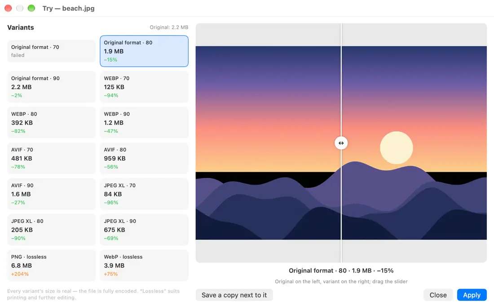</picture></p>

Not sure whether to pick WebP or AVIF, 70 or 80? Open the picture in the Try window: triflX actually encodes 15 variants (quality 70/80/90 for the original format, WebP, AVIF and JPEG XL, plus “lossless” modes for print) and shows the **real size** and savings of each. A before/after slider shows the difference. Pick one and press Apply.

- **How to open:** the “Try” button on the result card · the triflX menu · Finder → right-click → triflX… → “Try variants…” · hotkey ⌃⇧V · `triflx try file`.
- **Example** (a 3000×2000 sunset test image, 2.2 MB): the original format at 80 is 1.9 MB (−15%), WebP·80 is 392 KB (−82%), AVIF·70 is 481 KB (−78%), JPEG XL·70 is 84 KB (−96%). That image has smooth gradients; real photos usually save less.

<p align="center"></p>

### 2. Profiles by source
Different files, different rules. A profile matches by **folder**, **app** (where the clipboard content came from), **screenshots**, **the site a file was downloaded from**, or part of the name. A profile sets format, quality, scale, max side, metadata, a “fit into N MB” limit, replace-or-copy - or simply “leave alone”.
- **How to enable:** Settings → “Profiles” → “Add profile from template”. It applies to automation (folders, clipboard, background): the first match from the top wins.
- **Examples:** “screenshots → WebP, up to 1600 px”, “folder Clients/Print → leave alone”, “downloaded from unsplash.com → JPEG 85”.

<p align="center"><picture><source media="(prefers-color-scheme: dark)" srcset="docs/assets/shots/en-dark-p-profiles.webp">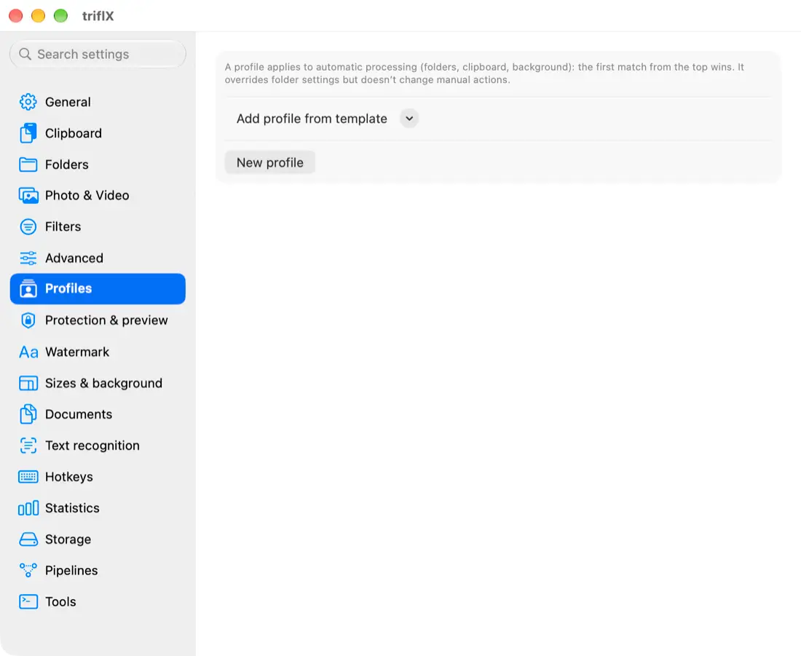</picture></p>

### 3. “Fit into N MB”: smart size for a target
Need “under 25 MB for email” or “under 10 MB for a messenger”? Set the limit and triflX picks quality and scale for images, a resolution ladder for video and dpi for PDF. If the target is unreachable you get the smallest possible result and an honest “size target not reached” note on the card. A file that’s already under the limit is left alone.
- **Where:** the “Fit into size” menu on the card (2 / 5 / 10 / 25 / 50 MB or custom), the “25 MB (email)”, “10 MB (Telegram)” and “custom limit” presets, the batch window, Shortcuts, `--max-size 25MB`.
- **Examples (test files):** a 1.66 MB photo with a 300 KB limit → **268 KB**. A 206 KB PNG screenshot with a 100 KB limit → **92 KB**. A 2.86 MB video with a 1 MB limit → **616 KB** (stepwise resolution reduction). A 1 KB limit for a photo is unreachable → 29 KB and a note.

### 4. Statistics: how much you’ve saved
<p align="center"><picture><source media="(prefers-color-scheme: dark)" srcset="docs/assets/shots/en-dark-w-stats.webp">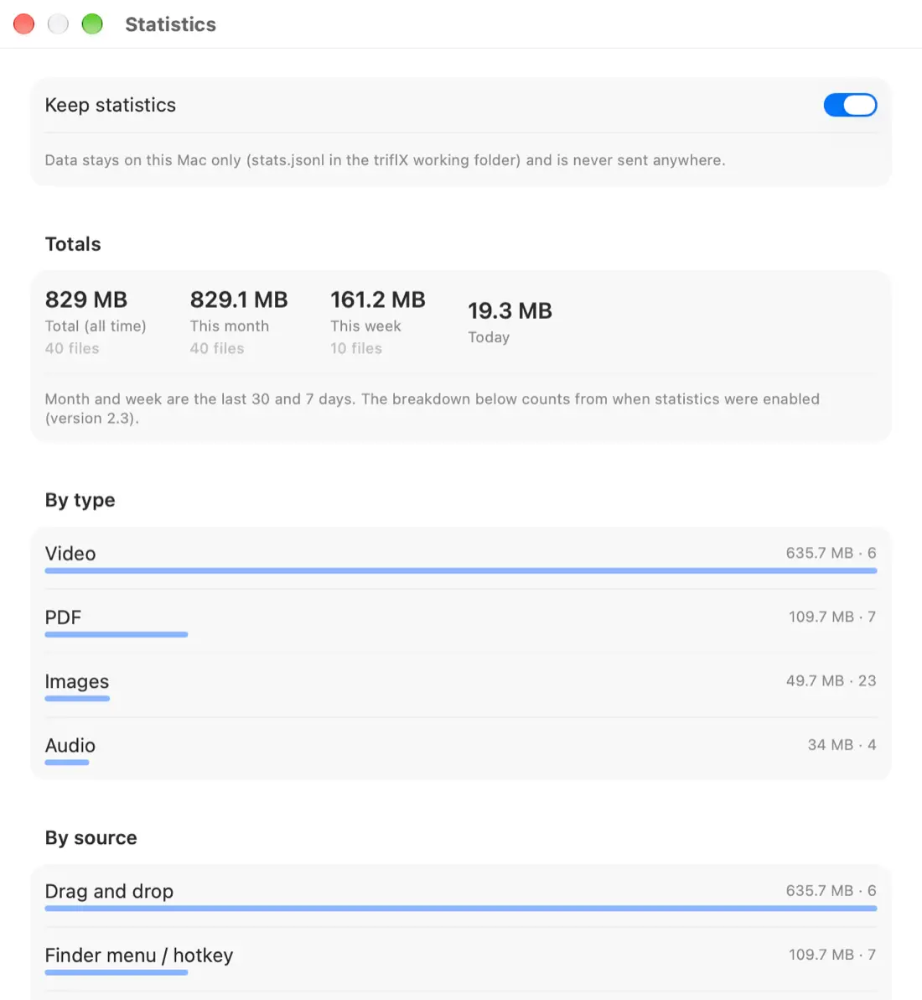</picture></p>
Total, month, week, today; breakdowns by file type, source and folder; a ranking of the biggest savings. The week total is shown in the menu. All data lives on your Mac in `stats.jsonl`, with an on/off switch and a Reset button.
- **How to open:** menu → “Statistics…” · Settings → “Statistics” · `triflx stats [--json]`.

### 5. Drop files on the icon: a one-time window
Drop files on the triflX menu-bar icon: the batch window opens where you choose format, size, limit, background and watermark **for this batch only**, without permanent rules. Hold ⌥ when dropping to compress right away, ⌘ for strong compression. The window can be turned off in General.

<p align="center"><picture><source media="(prefers-color-scheme: dark)" srcset="docs/assets/shots/en-dark-w-batch.webp">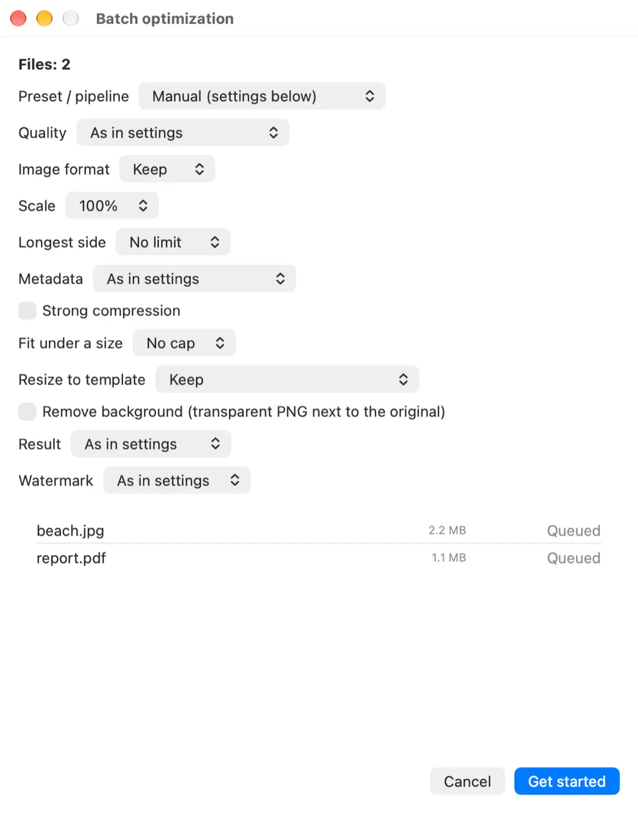</picture></p>

### 6. Hotkeys, including “optimize selection in Finder”
Select files in Finder, press a shortcut - done. Shortcuts are configured in “Hotkeys” (click the field and press keys; Esc cancels, ⌫ turns it off). “Selection in Finder” needs permission to control Finder (System Settings → Privacy → Automation); Settings has a “Request / check” button and a clear hint if access is missing.
<p align="center"><picture><source media="(prefers-color-scheme: dark)" srcset="docs/assets/shots/en-dark-p-hotkeys.webp">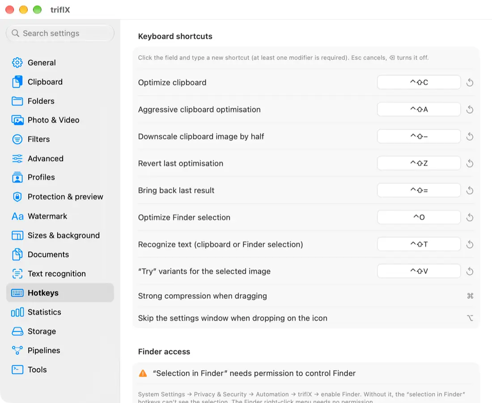</picture></p>

### 7. History and soft rollback of originals
<p align="center"><picture><source media="(prefers-color-scheme: dark)" srcset="docs/assets/shots/en-dark-w-history.webp">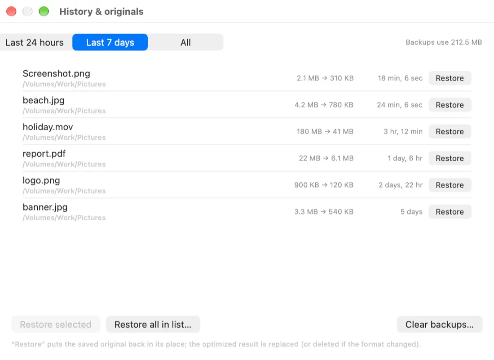</picture></p>
Originals used to be kept “N days”. Now there are three modes: “don’t keep” (≈30 minutes for “Restore”), “keep N days” and “keep up to a size limit” (the oldest are deleted first). The **History & originals** window restores files from the last 24 hours, 7 days or selectively; it shows how much space the backups use and has “Clear now”. Backups younger than two minutes are never deleted.

### 8. Safe preview
Off by default. Turn it on and before replacing a file triflX shows before/after and asks: **Replace**, **Keep original** or **Save a “.min” copy**. It can be enabled separately for automation and manual actions, for selected folders and file types only.

### 9. Protection: what triflX never touches
By default automation skips `.git`, Xcode projects, `DerivedData`, `node_modules`, Photoshop and Adobe caches, Photos libraries, system folders and iCloud files that aren’t downloaded yet. Name, path and extension lists are editable. Manual actions aren’t blocked, they warn: “Skip protected” or “Process anyway”. The terminal needs `--force`.
<p align="center"><picture><source media="(prefers-color-scheme: dark)" srcset="docs/assets/shots/en-dark-p-protect.webp">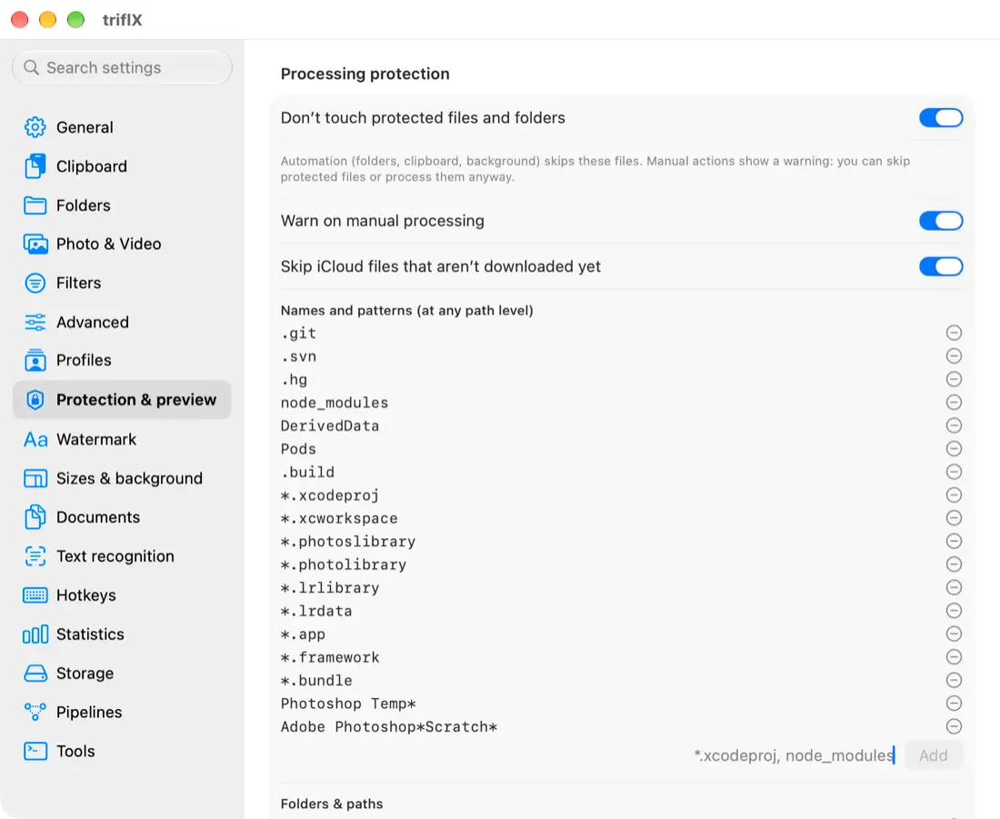</picture></p>

### 10. Watermark
Text or a logo image, position on a 3×3 grid, size, opacity, font, colour, shadow, margin and a **live preview right in Settings**. Enabled separately for automation, presets and manual actions, and can be limited to types and folders. Off by default. Terminal: `--watermark "© Name" --wm-pos br`.
<p align="center"><picture><source media="(prefers-color-scheme: dark)" srcset="docs/assets/shots/en-dark-p-watermark.webp">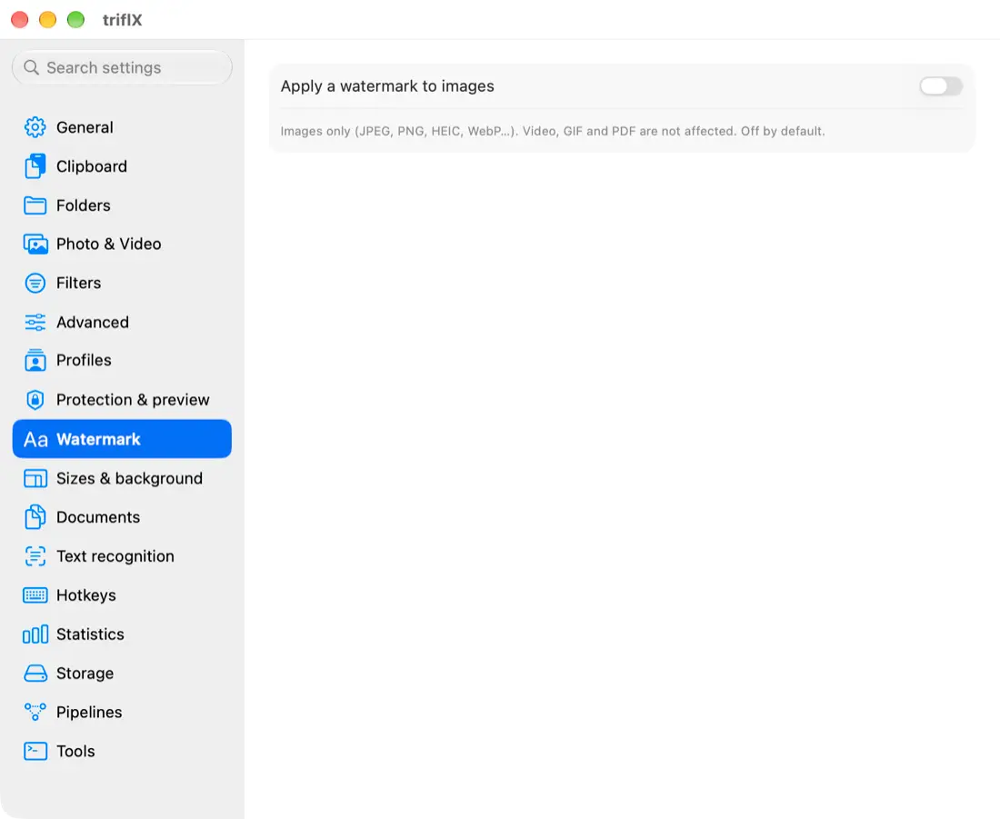</picture></p>

### 11. Documents: HEIC/RAW, PDF ↔ images, merge and split
- **HEIC / RAW → JPEG or PNG**.
- **PDF → images:** format (PNG/JPEG/WebP), dpi, page range `1-3,5`, subfolder.
- **Images → one PDF:** order, page size (match image, A4, Letter), margins, compression.
- **Merge PDFs** and **split PDF** (one page each, every N pages, by ranges).
All available from the triflX menu, the Finder menu, Shortcuts and `triflx convert`. The result is always saved next to the source files; originals aren’t changed.
<p align="center"><picture><source media="(prefers-color-scheme: dark)" srcset="docs/assets/shots/en-dark-p-docs.webp">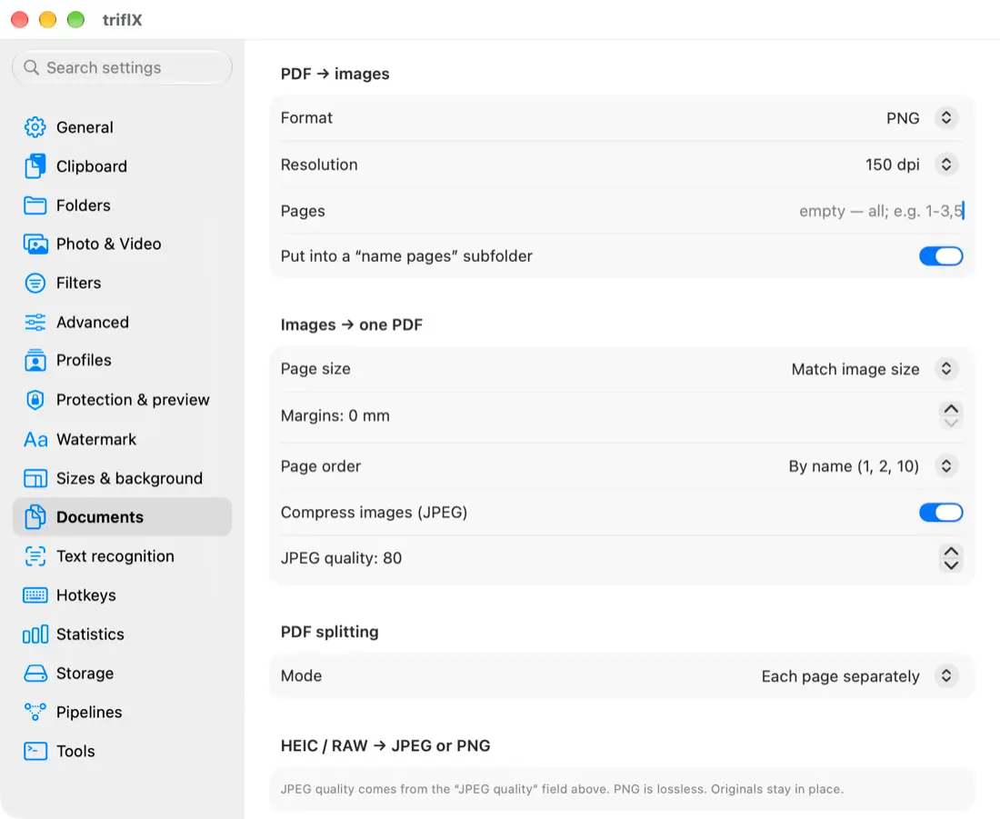</picture></p>

### 12. Background removal and size templates
- **Remove background** (macOS 14+): Vision cuts the subject out on-device, producing a transparent PNG “name-nobg.png” (or a white/custom background).
- **Resize to template:** exact sizes for platforms: marketplace 1000×1000 and 900×1200, Instagram 1080×1350, story 1080×1920, Open Graph 1200×630, video thumbnail, header, avatar. “Fit”, “Fill” and “Smart crop” modes (the frame shifts toward the main subject). Add your own templates in Settings, and show any template as a preset.
- **Example:** a 3000×2000 photo, 1.66 MB → Instagram 1080×1350: **926 KB**; Open Graph 1200×630: **557 KB**; marketplace 1000×1000: **523 KB**.
<p align="center"><picture><source media="(prefers-color-scheme: dark)" srcset="docs/assets/shots/en-dark-p-sizes.webp">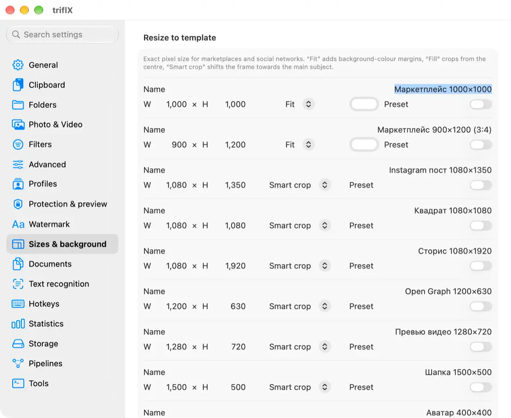</picture></p>

### 13. Text recognition (OCR)
On-device Vision, offline: a screenshot, a photo of a document or a PDF → text on the clipboard or in a `.txt` next to it. Language choice, a fast mode, and “recognize text in clipboard screenshots” (the text is put on the clipboard next to the image). Start it with ⌃⇧T, the menu, Finder, Shortcuts or `triflx ocr`.
<p align="center"><picture><source media="(prefers-color-scheme: dark)" srcset="docs/assets/shots/en-dark-p-ocr.webp">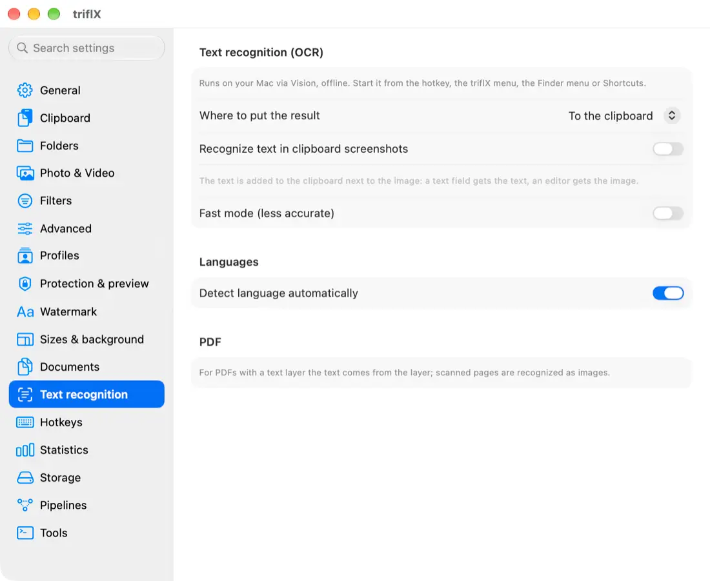</picture></p>

### Also in 2.3.0
- The Finder menu has a **“triflX…”** submenu: try, OCR, remove background, resize to template, documents.
- Seven new Shortcuts actions: Fit File to Size, Resize to Template, Remove Background, Recognize Text, PDF to Images, Images to PDF, Merge PDFs.
- New terminal and MCP options: `--template`, `--remove-bg`, `--lossless`, `--quality 1..100`, `--watermark`, `--force`, commands `ocr`, `remove-bg`, `try`, `stats`, `convert`.
- Fully bilingual (Russian and English) interface. Details and every change: see the [Changelog](CHANGELOG.en.md).

<p align="center"></p>

> The schematic illustrations (result card, slider, Finder menu) are hand-drawn and labelled as diagrams; the Try, History, Statistics, batch window and Settings tabs are real screenshots on test files.

---

## What’s new in 2.2.0

- **Built-in ffmpeg converter** (LGPL, inside the app, nothing to install): MKV, WebM, AVI, TS, FLV, WMV, OGG, Opus, WMA, APE. Encoding is hardware-accelerated (VideoToolbox).
- **Finder menu:** right-click → “Optimize with triflX” for files and folders, plus “Preset for selection”.
- **Cancel:** a Cancel button on the card before compression starts (the pause before auto-processing is configurable) and during compression. The original stays untouched.
- **Platform presets:** Telegram, Instagram (post and story), web, email, Slack/Discord and your own.
- **Before/after comparison** right on the card, a **batch window** with settings, progress and “restore originals”.
- **“Already optimized” mark:** a file isn’t compressed twice.
- **Existing files:** “Process existing files” with a savings estimate, and a night-time background mode.

---

## Features and comparison

| | **triflX** | Online compressors | Manual export |
|---|:---:|:---:|:---:|
| Works automatically (clipboard, folders) | ✅ | ❌ | ❌ |
| Files stay on your Mac | ✅ | ❌ | ✅ |
| Images, video, GIF, PDF, audio in one place | ✅ | partly | depends on the app |
| WebP, AVIF, JPEG XL, HEIC | ✅ | partly | depends on the app |
| “Fit into N MB” | ✅ | rarely | by trial and error |
| Roll back the original | ✅ | - | - |
| Command line and MCP for AI agents | ✅ | ❌ | ❌ |
| Price | free | limits and ads | - |

**Ways to start it:** clipboard · watched folders · drag and drop onto the window and the icon · Finder menu · hotkeys · Shortcuts · terminal · MCP.

## Formats

| Type | What is handled |
|---|---|
| Images | JPEG, PNG, HEIC, WebP, AVIF, JPEG XL, TIFF, BMP (+ conversion between them) |
| Animation | GIF |
| Video | MP4, MOV; via the built-in ffmpeg - MKV, WebM, AVI, TS, FLV, WMV |
| Audio | WAV, AIFF, FLAC, MP3, M4A, OGG, Opus, WMA, APE → AAC/M4A (with loudness normalization and cover art handling) |
| Documents | PDF (compress, MRC for scans, split, merge, PDF ↔ images), HEIC/RAW → JPEG/PNG |

## Install in 3 steps

1. **Download** [triflX.dmg](../../releases/latest) (signed and notarized by Apple).
2. **Drag** triflX to Applications and launch it. The icon appears in the menu bar.
3. **Done:** take a screenshot or drop a file on the icon. Settings: menu → “Settings…”. Updates arrive automatically (Sparkle).

Requires macOS 13 or later; Apple Silicon and Intel. Some features need macOS 14+ (background removal).

## Hotkeys

| Shortcut | Action |
|---|---|
| ⌃⇧C | Optimize the clipboard |
| ⌃⇧A | Strong compression of the clipboard |
| ⌃⇧− | Halve the clipboard image |
| ⌃⇧Z | Restore the last result’s original |
| ⌃⇧= | Show the last result again |
| ⌃O | Optimize the selection in Finder (needs Finder access) |
| ⌃⇧T | Recognize text (OCR) |
| ⌃⇧V | Try variants for the selected image |

Shortcuts can be changed and turned off: Settings → “Hotkeys” (the full list of actions is there).

## Terminal, MCP and Shortcuts

```bash
triflx optimize --max-size 25MB --template ig-post photo.jpg
triflx convert pdf2img --dpi 150 --pages 1-3 document.pdf
triflx ocr --lang ru,en --txt screenshot.png
triflx optimize --loudness 16 --cover shrink track.mp3
triflx optimize --mrc scan.pdf
triflx try photo.jpg
triflx stats --json
```

The `triflx` command is installed with one button: Settings → “Tools” → “Install the triflx command”. The **MCP server** (`triflx mcp`) gives AI agents an `optimize_file` tool. **Shortcuts actions:** Optimize Files, Compress/Convert/Resize/Fit/Crop Image, Compress Video, Video to GIF, Compress PDF, Apply Preset, Optimize Clipboard and the seven new 2.3 actions. Details: [guide, section 15](docs/GUIDE.en.md#15-terminal-and-ai-agents).

## Privacy

- **Everything is local.** Compression, OCR, background removal and conversion all run on your Mac.
- **No telemetry, no analytics.** The savings statistics are stored only on your Mac (`stats.jsonl`).
- **The only network requests** are update checks (Sparkle, the `appcast.xml` file in this repository) and downloading an update with your consent.
- Before replacing a file, the original is copied to the working folder (retention is configurable) and can be restored in one click.

## FAQ

**Does compression hurt quality?** By default triflX picks “smart” compression with no visible loss. Use the Try window to compare and the “lossless” mode for print.

**Can I get the original back?** Yes: the “Restore original” button on the card, the “Recent” menu, and the History & originals window.

**A file wasn’t processed.** It may be in a protected folder or already marked as optimized. See [troubleshooting](docs/GUIDE.en.md#21-troubleshooting).

**How do I uninstall triflX?** [Guide, section 22](docs/GUIDE.en.md#22-uninstall).

**Is it really free?** Yes.

## Documentation

- **[Guide (EN)](docs/GUIDE.en.md)** · **[Руководство (RU)](docs/GUIDE.ru.md)** - installation, every Settings tab, every feature, scenarios (email, messengers, web, print), troubleshooting, uninstall.
- **[Changelog](CHANGELOG.en.md)** · [История версий (RU)](CHANGELOG.md)
- [Download the latest version](../../releases/latest)
