<p align="center"></p>

<p align="center">
<a href="../../releases/latest"></a>


</p>

<p align="center"><b>Русский</b> · <a href="README.en.md">English</a> · <a href="docs/GUIDE.ru.md">Руководство</a> · <a href="CHANGELOG.md">История версий</a></p>

<h3 align="center"><a href="../../releases/latest">⬇️ Скачать triflX.dmg - последняя версия</a></h3>

## Зачем это нужно

Скриншот на 4 МБ, который не лезет в почту. Видео с телефона на 800 МБ. PDF-скан, который «весит как фильм». Вы тратите время на конвертеры, онлайн-сжималки (и отдаёте им свои файлы) или экспорт «с настройками».

**triflX живёт в строке меню и делает это сам.** Сделали скриншот - он уже сжат. Скачали фото в папку - оно сжато. Перетащили файл на значок - сжат. Размер файла уменьшается в разы, а на глаз ничего не меняется. Всё считается на вашем Mac: файлы никуда не отправляются, телеметрии нет, интернет нужен только для проверки обновлений.

<p align="center"></p>

## Содержание
- [Что нового в 2.3.0](#что-нового-в-230) - 13 новых возможностей
- [Что нового в 2.2.0](#что-нового-в-220)
- [Возможности и сравнение](#возможности-и-сравнение)
- [Форматы](#форматы)
- [Установка за 3 шага](#установка-за-3-шага)
- [Горячие клавиши](#горячие-клавиши)
- [Терминал, MCP и «Быстрые команды»](#терминал-mcp-и-быстрые-команды)
- [Приватность](#приватность)
- [FAQ](#faq)
- [Документация](#документация)

---

## Что нового в 2.3.0

В версии 2.3 добавилось 13 возможностей: сравнить варианты сжатия, уложить файл в лимит, защитить папки, откатить оригиналы, распознать текст и другие. Всё настраивается в окне настроек (слева список разделов, сверху поиск). Всё, что может изменить файлы неожиданно, по умолчанию выключено.

### 1. «Попробовать»: все варианты рядом, с настоящими размерами

<p align="center"><picture><source media="(prefers-color-scheme: dark)" srcset="docs/assets/shots/ru-dark-w-try.webp">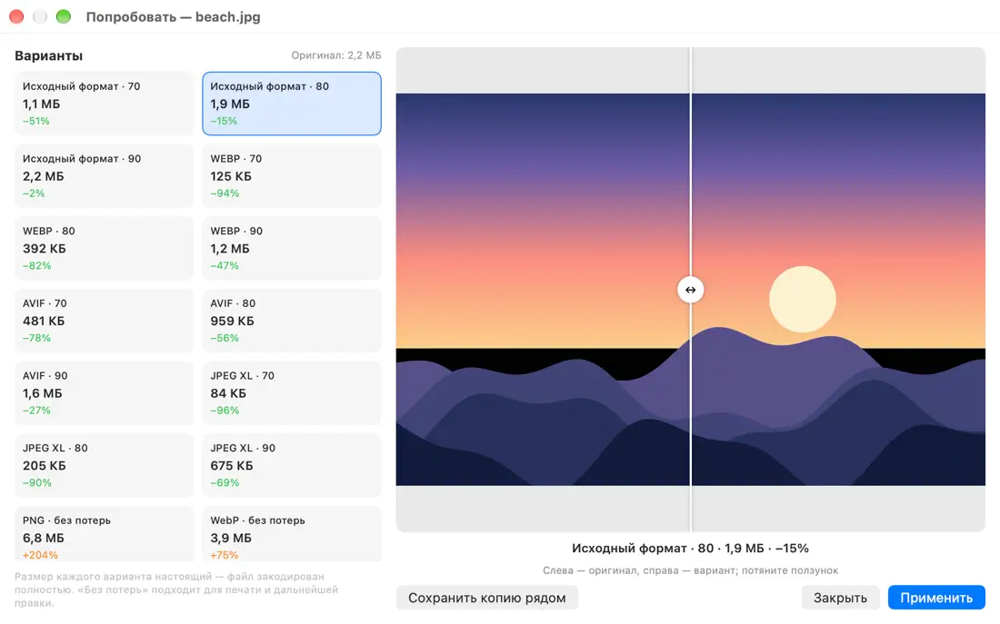</picture></p>

Не знаете, что выбрать: WebP или AVIF, 70 или 80? Откройте картинку в окне «Попробовать»: triflX по-настоящему кодирует 15 вариантов (качество 70/80/90 для исходного формата, WebP, AVIF и JPEG XL, плюс режимы «без потерь» для печати) и показывает **реальный размер** каждого и экономию. Шторка «до и после» показывает разницу глазами. Выбрали, нажали «Применить».

- **Как открыть:** кнопка «Попробовать» на карточке результата · меню triflX · Finder → правая кнопка → triflX… → «Попробовать варианты…» · горячая клавиша ⌃⇧V · `triflx try файл`.
- **Пример** (тестовая картинка-закат 3000×2000, 2,2 МБ): исходный формат при 80 - 1,9 МБ (−15%), WebP·80 - 392 КБ (−82%), AVIF·70 - 481 КБ (−78%), JPEG XL·70 - 84 КБ (−96%). Это картинка с плавными градиентами, на реальных фото экономия обычно скромнее.

<p align="center"></p>

### 2. Профили по источнику
Разные файлы - разные правила. Профиль выбирается по **папке**, **приложению** (откуда скопировано в буфер), **скриншотам**, **сайту, с которого скачан файл**, или по части имени. В профиле: формат, качество, масштаб, максимальная сторона, метаданные, лимит «уложить в N МБ», «заменять или копию» - или просто «не трогать».
- **Как включить:** Настройки → «Профили» → «Добавить профиль из шаблона». Работает для автоматики (папки, буфер, фон): сверху вниз побеждает первый подходящий.
- **Пример:** «скриншоты → WebP, до 1600 px», «папка Clients/Print → не трогать», «скачано с unsplash.com → JPEG 85».

<p align="center"><picture><source media="(prefers-color-scheme: dark)" srcset="docs/assets/shots/ru-dark-p-profiles.webp">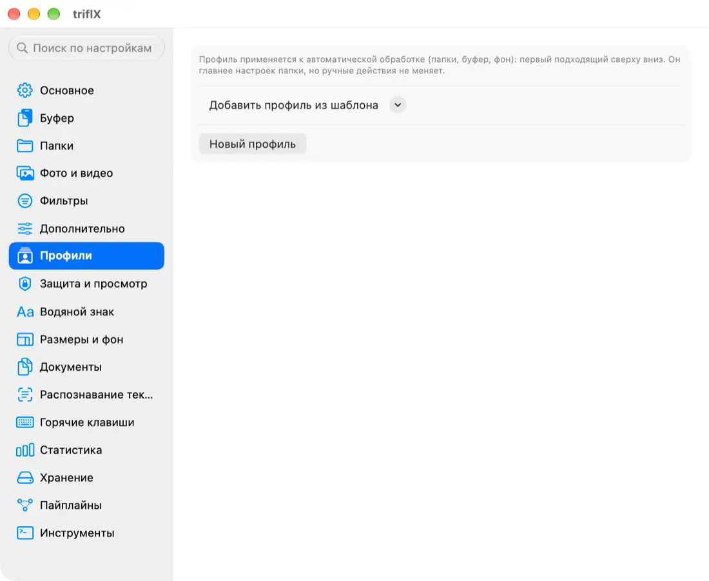</picture></p>

### 3. «Уложить в N МБ»: умный размер под цель
Нужно «влезть в 25 МБ для почты» или «в 10 МБ для мессенджера»? Укажите лимит, triflX сам подберёт качество и масштаб картинки, лесенку разрешений для видео и dpi для PDF. Если цель недостижима, получится самый маленький вариант, а на карточке будет честная пометка «цель по размеру не достигнута». Файл, который уже меньше лимита, не трогается.
- **Где:** меню «Уложить в размер» на карточке (2 / 5 / 10 / 25 / 50 МБ или свой), пресеты «25 МБ (почта)», «10 МБ (Telegram)» и «свой лимит», пакетное окно, «Быстрые команды», `--max-size 25MB`.
- **Примеры (тестовые файлы):** фото 1,66 МБ → лимит 300 КБ → **268 КБ**. PNG-скриншот 206 КБ → лимит 100 КБ → **92 КБ**. Видео 2,86 МБ → лимит 1 МБ → **616 КБ** (ступенчатое понижение разрешения). Лимит 1 КБ для фото недостижим → результат 29 КБ и пометка.

### 4. Статистика: сколько вы сэкономили
<p align="center"><picture><source media="(prefers-color-scheme: dark)" srcset="docs/assets/shots/ru-dark-w-stats.webp">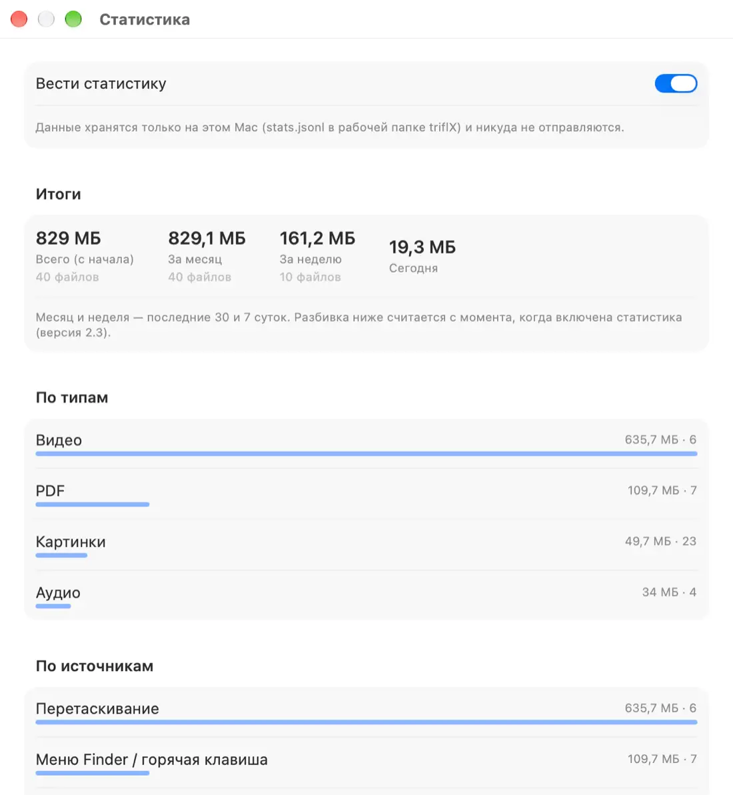</picture></p>
Всего, за месяц, за неделю, сегодня; разбивка по типам файлов, по источникам и по папкам; рейтинг самых больших экономий. Сумма за неделю показана в меню. Все данные лежат на Mac в `stats.jsonl`, есть выключатель и кнопка «Сбросить».
- **Как открыть:** меню → «Статистика…» · Настройки → «Статистика» · `triflx stats [--json]`.

### 5. Перетащите файлы на значок: окно «на один раз»
Перетащите файлы на значок triflX в строке меню: откроется пакетное окно, где можно выбрать формат, размер, лимит, фон и водяной знак **только для этой пачки**, без постоянных правил. Удерживайте ⌥ при отпускании - сжать сразу; ⌘ - сильное сжатие. Окно можно отключить в «Основное».

<p align="center"><picture><source media="(prefers-color-scheme: dark)" srcset="docs/assets/shots/ru-dark-w-batch.webp">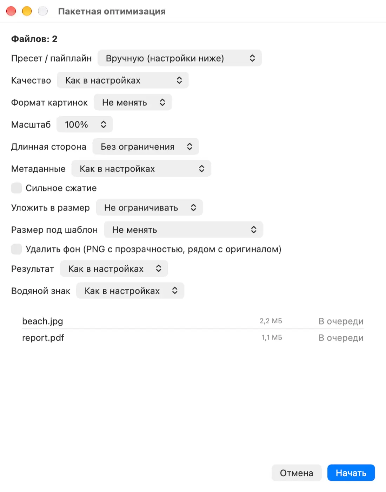</picture></p>

### 6. Горячие клавиши, включая «оптимизировать выделенное в Finder»
Выделили файлы в Finder, нажали сочетание - всё сжато. Сочетания настраиваются в «Горячие клавиши» (кликните в поле и нажмите клавиши; Esc - отмена, ⌫ - выключить). Для «выделенного в Finder» нужен доступ к управлению Finder (Системные настройки → Конфиденциальность → Автоматизация); в настройках есть кнопка «Запросить / проверить» и понятная подсказка, если доступа нет.
<p align="center"><picture><source media="(prefers-color-scheme: dark)" srcset="docs/assets/shots/ru-dark-p-hotkeys.webp">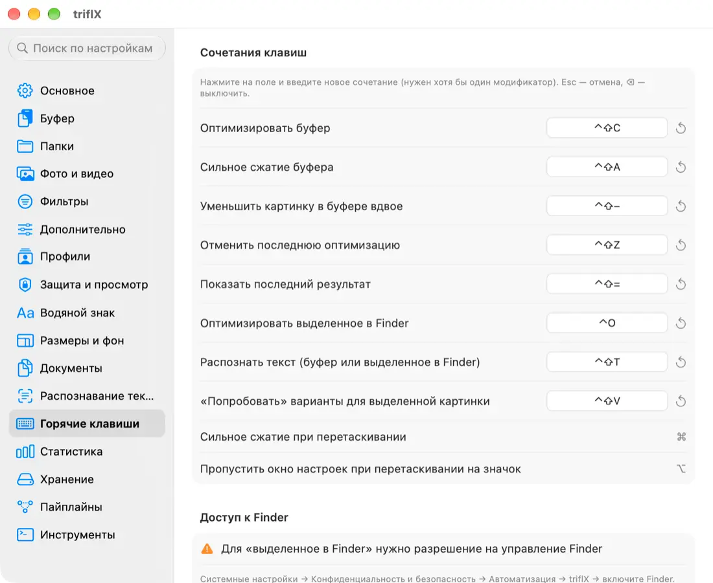</picture></p>

### 7. История и мягкий откат оригиналов
<p align="center"><picture><source media="(prefers-color-scheme: dark)" srcset="docs/assets/shots/ru-dark-w-history.webp">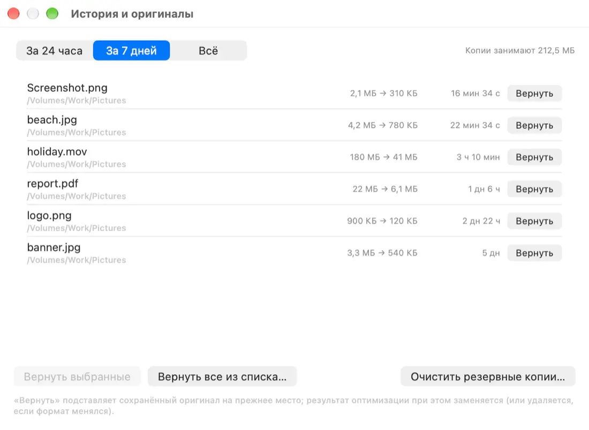</picture></p>
Раньше оригиналы хранились «N дней». Теперь три режима: «не хранить» (≈30 минут на «Вернуть»), «хранить N дней» и «хранить до лимита по размеру» (самые старые удаляются первыми). Окно **«История и оригиналы»** возвращает файлы за 24 часа, 7 дней или выборочно; показано, сколько места занимают копии, есть «Очистить сейчас». Копии младше двух минут не удаляются никогда.

### 8. Безопасный просмотр
Выключено по умолчанию. Включите, и перед заменой файла triflX покажет «до и после» и спросит: **Заменить**, **Оставить оригинал** или **Сохранить копию «.min»**. Включается отдельно для автоматики и ручных действий, только для выбранных папок и типов файлов.

### 9. Защита: что triflX не трогает никогда
По умолчанию автоматика пропускает `.git`, проекты Xcode, `DerivedData`, `node_modules`, кэши Photoshop и Adobe, библиотеки «Фото», системные папки, а также файлы iCloud, которые ещё не скачаны. Списки имён, путей и расширений можно править. Ручные действия не блокируются, а предупреждают: «Пропустить защищённые» или «Всё равно обработать». В терминале нужен `--force`.
<p align="center"><picture><source media="(prefers-color-scheme: dark)" srcset="docs/assets/shots/ru-dark-p-protect.webp">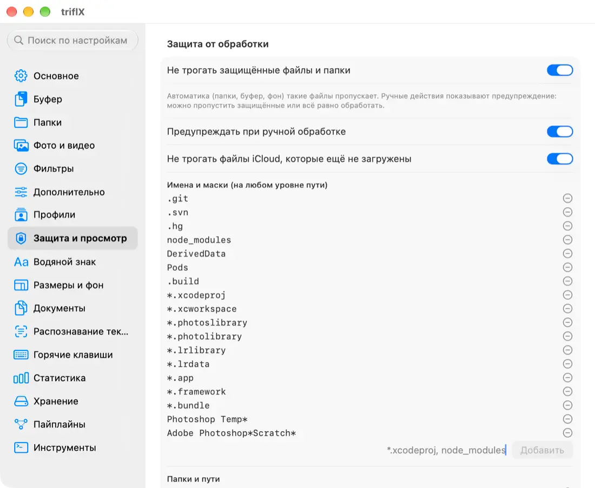</picture></p>

### 10. Водяной знак
Текст или картинка-логотип, положение на сетке 3×3, размер, прозрачность, шрифт, цвет, тень, отступ и **предпросмотр прямо в настройках**. Включается отдельно для автоматики, пресетов и ручных действий, можно ограничить типами и папками. По умолчанию выключено. Терминал: `--watermark "© Имя" --wm-pos br`.
<p align="center"><picture><source media="(prefers-color-scheme: dark)" srcset="docs/assets/shots/ru-dark-p-watermark.webp">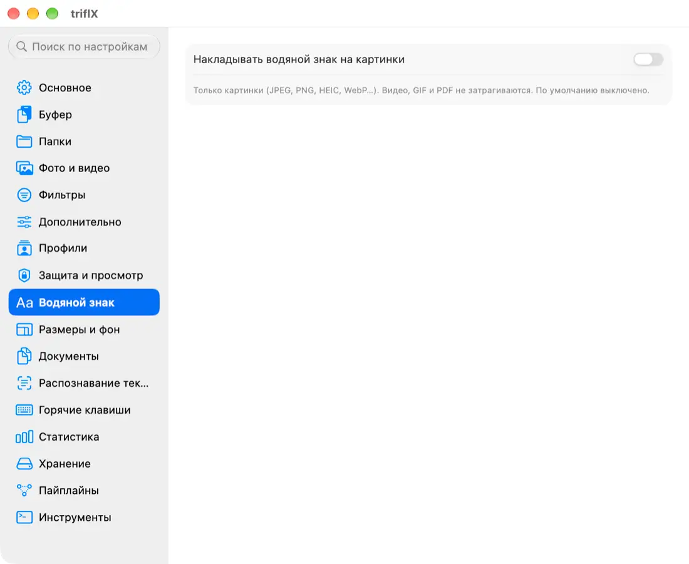</picture></p>

### 11. Документы: HEIC/RAW, PDF ↔ картинки, склеить и разбить
- **HEIC / RAW → JPEG или PNG**.
- **PDF → картинки:** формат (PNG/JPEG/WebP), dpi, диапазон страниц `1-3,5`, подпапка.
- **Картинки → один PDF:** порядок, размер страницы (по картинке, A4, Letter), поля, сжатие.
- **Склеить PDF** и **разбить PDF** (по странице, по N страниц, по диапазонам).
Всё доступно из меню triflX, меню Finder, «Быстрых команд» и командой `triflx convert`. Результат всегда рядом с исходными файлами, оригиналы не меняются.
<p align="center"><picture><source media="(prefers-color-scheme: dark)" srcset="docs/assets/shots/ru-dark-p-docs.webp">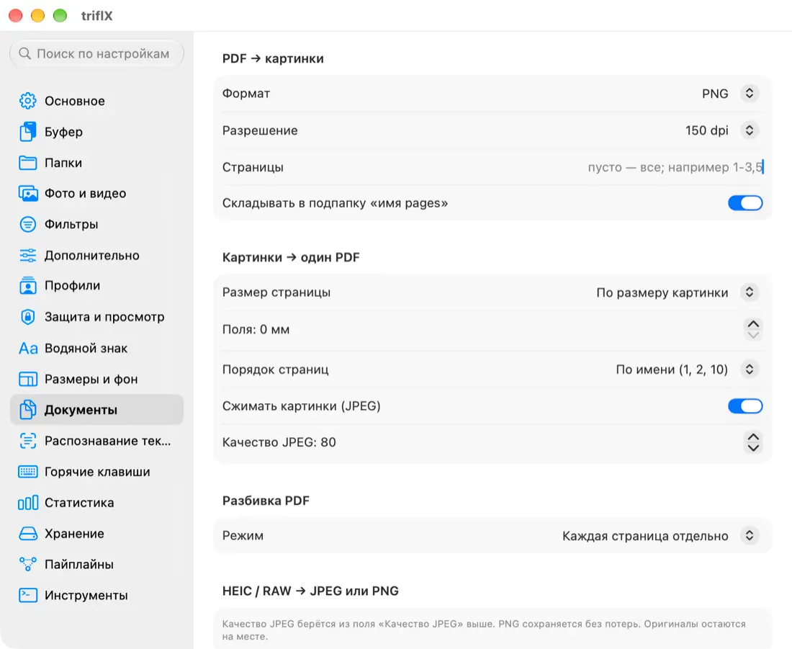</picture></p>

### 12. Удаление фона и размеры под шаблоны
- **Удалить фон** (macOS 14+): Vision вырезает объект на устройстве, получается PNG с прозрачностью «имя-nobg.png» (или белый/свой фон).
- **Размер под шаблон:** точные размеры для площадок: маркетплейс 1000×1000 и 900×1200, Instagram 1080×1350, сторис 1080×1920, Open Graph 1200×630, превью видео, шапка, аватар. Режимы «Вписать», «Заполнить» и «Умная обрезка» (кадр смещается к главному объекту). Свои шаблоны добавляются в настройках, а любой шаблон можно показать как пресет.
- **Пример:** фото 3000×2000, 1,66 МБ → Instagram 1080×1350: **926 КБ**; Open Graph 1200×630: **557 КБ**; маркетплейс 1000×1000: **523 КБ**.
<p align="center"><picture><source media="(prefers-color-scheme: dark)" srcset="docs/assets/shots/ru-dark-p-sizes.webp">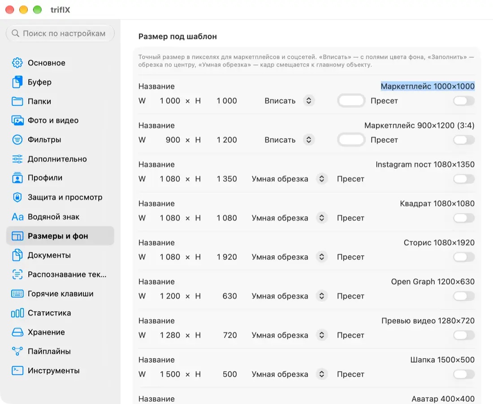</picture></p>

### 13. Распознавание текста (OCR)
Vision на устройстве, без интернета: скриншот, фото документа или PDF → текст в буфер обмена или в `.txt` рядом. Выбор языков, быстрый режим, опция «распознавать текст на скриншотах из буфера» (текст кладётся в буфер рядом с картинкой). Запуск: ⌃⇧T, меню, Finder, «Быстрые команды», `triflx ocr`.
<p align="center"><picture><source media="(prefers-color-scheme: dark)" srcset="docs/assets/shots/ru-dark-p-ocr.webp">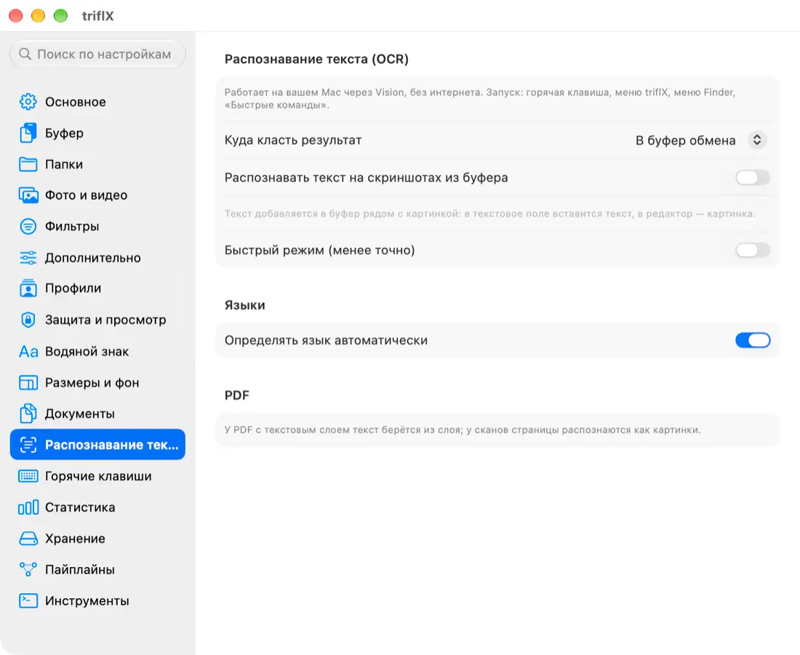</picture></p>

### Ещё в 2.3.0
- Меню Finder получило подменю **«triflX…»**: попробовать, OCR, удалить фон, размер под шаблон, документы.
- Семь новых действий в «Быстрых командах»: Fit File to Size, Resize to Template, Remove Background, Recognize Text, PDF to Images, Images to PDF, Merge PDFs.
- Новые параметры терминала и MCP: `--template`, `--remove-bg`, `--lossless`, `--quality 1..100`, `--watermark`, `--force`, команды `ocr`, `remove-bg`, `try`, `stats`, `convert`.
- Интерфейс полностью на русском и английском. Подробности и все изменения - в [CHANGELOG](CHANGELOG.md).

<p align="center"></p>

> Иллюстрации-схемы (карточка результата, шторка, меню Finder) нарисованы вручную и подписаны как схемы; окна «Попробовать», «История», «Статистика», пакетное окно и вкладки настроек - настоящие скриншоты на тестовых файлах.

---

## Что нового в 2.2.0

- **Встроенный конвертер ffmpeg** (LGPL, внутри приложения, без установки): MKV, WebM, AVI, TS, FLV, WMV, OGG, Opus, WMA, APE. Кодирование идёт аппаратно (VideoToolbox), исходники конвертера доступны по условиям LGPL.
- **Меню Finder:** правая кнопка → «Оптимизировать с triflX» для файлов и папок, плюс «Пресет для выделенного».
- **Отмена:** кнопка «Отмена» на карточке до начала сжатия (пауза перед автообработкой настраивается) и во время сжатия. Оригинал остаётся нетронутым.
- **Пресеты площадок:** Telegram, Instagram (пост и сторис), веб, почта, Slack/Discord и ваши.
- **Сравнение до/после** прямо на карточке, **пакетное окно** с настройками, прогрессом и «вернуть оригиналы».
- **Метка «уже оптимизировано»:** файл не сжимается повторно.
- **Существующие файлы:** «Обработать существующие» с оценкой экономии и фоновый режим ночью.

---

## Возможности и сравнение

| | **triflX** | Онлайн-сжималки | Ручной экспорт |
|---|:---:|:---:|:---:|
| Работает автоматически (буфер, папки) | ✅ | ❌ | ❌ |
| Файлы остаются на вашем Mac | ✅ | ❌ | ✅ |
| Картинки, видео, GIF, PDF, аудио в одном месте | ✅ | частично | зависит от приложения |
| WebP, AVIF, JPEG XL, HEIC | ✅ | частично | зависит от приложения |
| «Уложить в N МБ» | ✅ | редко | вручную подбором |
| Откат оригинала | ✅ | - | - |
| Командная строка и MCP для ИИ-агентов | ✅ | ❌ | ❌ |
| Цена | бесплатно | лимиты и реклама | - |

**Способы запустить:** буфер обмена · наблюдаемые папки · перетаскивание в окно и на значок · меню Finder · горячие клавиши · «Быстрые команды» · терминал · MCP.

## Форматы

| Тип | Что обрабатывается |
|---|---|
| Картинки | JPEG, PNG, HEIC, WebP, AVIF, JPEG XL, TIFF, BMP (+ конвертация между ними) |
| Анимация | GIF |
| Видео | MP4, MOV; через встроенный ffmpeg - MKV, WebM, AVI, TS, FLV, WMV |
| Аудио | WAV, AIFF, FLAC, MP3, OGG, Opus, WMA, APE → AAC/M4A |
| Документы | PDF (сжатие, разбивка, склейка, PDF ↔ картинки), HEIC/RAW → JPEG/PNG |

## Установка за 3 шага

1. **Скачайте** [triflX.dmg](../../releases/latest) (подписан и нотаризован Apple).
2. **Перетащите** triflX в «Программы» и запустите. Значок появится в строке меню.
3. **Готово:** сделайте скриншот или перетащите файл на значок. Настройки: меню → «Настройки…». Обновления приходят сами (Sparkle).

Требуется macOS 13 или новее; Apple Silicon и Intel. Некоторые функции требуют macOS 14+ (удаление фона).

## Горячие клавиши

| Сочетание | Действие |
|---|---|
| ⌃⇧C | Оптимизировать буфер |
| ⌃⇧A | Сильное сжатие буфера |
| ⌃⇧− | Уменьшить картинку в буфере вдвое |
| ⌃⇧Z | Вернуть оригинал последнего результата |
| ⌃⇧= | Показать последний результат снова |
| ⌃O | Оптимизировать выделенное в Finder (нужен доступ к Finder) |
| ⌃⇧T | Распознать текст (OCR) |
| ⌃⇧V | Попробовать варианты для выделенной картинки |

Сочетания можно менять и выключать: Настройки → «Горячие клавиши» (там же полный список действий).

## Терминал, MCP и «Быстрые команды»

```bash
triflx optimize --max-size 25MB --template ig-post фото.jpg
triflx convert pdf2img --dpi 150 --pages 1-3 документ.pdf
triflx ocr --lang ru,en --txt скриншот.png
triflx try фото.jpg
triflx stats --json
```

Команда `triflx` ставится одной кнопкой: Настройки → «Инструменты» → «Установить команду triflx». **MCP-сервер** (`triflx mcp`) даёт ИИ-агентам инструмент `optimize_file`. **«Быстрые команды»:** Optimize Files, Compress/Convert/Resize/Fit/Crop Image, Compress Video, Video to GIF, Compress PDF, Apply Preset, Optimize Clipboard и семь новых действий 2.3. Подробности: [руководство, раздел 15](docs/GUIDE.ru.md#15-терминал-и-ии-агенты).

## Приватность

- **Всё локально.** Сжатие, OCR, удаление фона и конвертация выполняются на вашем Mac.
- **Без телеметрии и аналитики.** Статистика экономии хранится только у вас (`stats.jsonl`).
- **Единственные сетевые запросы** - проверка обновлений (Sparkle, файл `appcast.xml` в этом репозитории) и скачивание обновления по вашему согласию.
- Оригинал перед заменой копируется в рабочую папку (срок хранения настраивается), его можно вернуть в один клик.

## FAQ

**Сжатие портит качество?** По умолчанию выбирается «умное» сжатие без заметных на глаз потерь. Для сравнения есть окно «Попробовать», для печати - режим «без потерь».

**Можно ли вернуть оригинал?** Да: кнопка «Вернуть оригинал» на карточке, меню «Недавние», окно «История и оригиналы».

**Файл не обработался.** Возможно, он в защищённой папке или уже помечен как оптимизированный. См. [траблшутинг](docs/GUIDE.ru.md#21-если-что-то-не-работает).

**Как удалить triflX?** [Раздел 22 руководства](docs/GUIDE.ru.md#22-удаление).

**Это точно бесплатно?** Да.

## Документация

- **[Руководство (RU)](docs/GUIDE.ru.md)** · **[Guide (EN)](docs/GUIDE.en.md)** - установка, все вкладки настроек, каждая функция, сценарии (почта, мессенджеры, сайт, печать), траблшутинг, удаление.
- **[История версий](CHANGELOG.md)** · [Changelog (EN)](CHANGELOG.en.md)
- [Скачать последнюю версию](../../releases/latest)
