# triflX - user guide

triflX shrinks images, GIFs, video, PDF and audio on your Mac. It lives in the menu bar, works in the background and never uploads anything. Guide version: 2.2.

[Русская версия](GUIDE.ru.md) · [Download](../../../releases/latest)

## Contents
1. [Install and first launch](#1-install-and-first-launch)
2. [How it works](#2-how-it-works)
3. [Ways to start compression](#3-ways-to-start-compression)
4. [The result card](#4-the-result-card)
5. [Supported formats](#5-supported-formats)
6. [Settings window, tab by tab](#6-settings-window-tab-by-tab)
7. [Platform presets](#7-platform-presets)
8. [Pipelines and quick-action zones](#8-pipelines-and-quick-action-zones)
9. [Batch processing](#9-batch-processing)
10. [Existing files and background mode](#10-existing-files-and-background-mode)
11. [The “already optimized” mark](#11-the-already-optimized-mark)
12. [Cancel and restore the original](#12-cancel-and-restore-the-original)
13. [Finder menu](#13-finder-menu)
14. [Shortcuts](#14-shortcuts)
15. [Terminal and AI agents](#15-terminal-and-ai-agents)
16. [Built-in ffmpeg converter](#16-built-in-ffmpeg-converter)
17. [Where things are stored](#17-where-things-are-stored)
18. [FAQ](#18-faq)
19. [Version 2.3: new features](#19-version-23-new-features)
20. [Scenarios](#20-scenarios-set-it-up-for-a-task)
21. [Troubleshooting](#21-troubleshooting)
22. [Uninstall](#22-uninstall)

---

## 1. Install and first launch
1. Download `triflX.dmg` from [Releases](../../../releases/latest), open it and drag triflX to Applications.
2. The app is signed and notarized by Apple. macOS 13+, Apple Silicon and Intel.
3. A welcome screen with tips appears on first launch. There is no Dock icon - look for the menu-bar icon.
4. Updates arrive automatically (Sparkle). Manual check: menu → “Check for Updates…”.

Clicking the icon opens the menu: statistics, clipboard actions, zones, presets, pause, backups, settings.

## 2. How it works
For every file triflX:
1. Copies the original to the backup folder (`~/Library/Application Support/triflX/Backups`).
2. Compresses it. The result is written **only if it is smaller**; for transformations (format, scale, crop, conversion) it is always written.
3. Shows a result card with a “Restore original” button.

Your files stay on disk; nothing is uploaded. Backups are removed after the configured number of days (7 by default).

## 3. Ways to start compression
| Way | What happens |
|---|---|
| **Clipboard** | A screenshot or image copied to the clipboard is replaced with the compressed version. Files copied in Finder (⌘C) too. |
| **Folders** | New files in watched folders are compressed automatically (you choose the folders in settings). |
| **Drag and drop** | Drop files or folders on the menu-bar icon, the “Drop zone”, or the settings window. Hold ⌘ on release for stronger compression. |
| **Finder menu** | Right-click → “Optimize with triflX” ([section 13](#13-finder-menu)). Also the “Optimize in triflX” Service and “Open With”. |
| **Hotkeys** | See the table below. |
| **Shortcuts** | Native triflX actions ([section 14](#14-shortcuts)). |
| **Terminal / AI** | The `triflx` command and MCP ([section 15](#15-terminal-and-ai-agents)). |

Hotkeys (work from any app):

| Keys | Action |
|---|---|
| ⌃⇧C | Optimize the clipboard |
| ⌃⇧A | Strong compression of the clipboard |
| ⌃⇧− | Halve the image on the clipboard |
| ⌃⇧Z | Undo the last optimization (restore original) |
| ⌃⇧= | Show the last result again |
| ⌃O | Optimize files selected in Finder (macOS asks for “Automation” permission the first time) |

## 4. The result card
After compression a card appears in the bottom-right corner: thumbnail, size “before → after”, percentage.
- **Click the thumbnail** to open the before/after comparison (a slider for images, two frames for video and PDF). The thumbnail can be dragged into any app.
- **“Restore original”** is visible right away and restores the file from the backup.
- Action icons: Compare, Presets, Strong compression, “For messengers” (images up to 1280 px, video 720p up to 16 MB), Downscale (75/50/25%), Convert (WebP, JPEG XL, JPEG, PNG, HEIC, AVIF), Fit to size (500 KB / 1 / 2 / 5 MB), Crop (16:9, 4:3, 3:2, 1:1, 9:16; PDF: A4 and square); for video - Mute, Speed (×0.5/1.5/2/4), Make GIF. Also: Copy, Open in external editor, Show in Finder, Share, AirDrop, “Stop watching this folder”.
- Every card operation is computed **from the original**, not from the already-compressed file, so quality losses don't pile up.
- The card stays for the configured time (15 s by default) and **never hides while the pointer is over it**. Bring the last one back with ⌃⇧=. All recent results are in the menu → “Recent results” (with restore later).

## 5. Supported formats
| Kind | Input | How it is compressed |
|---|---|---|
| Images | JPEG, PNG, HEIC, WebP, AVIF, JPEG XL, TIFF, BMP | Re-encoding with tuned quality, custom PNG quantizer, WebP/JPEG XL/AVIF/HEIC output, smart crop, side and size limits |
| GIF | GIF | Frame and palette reduction, optional speed-up |
| Video | MP4, MOV, M4V, MPG, plus MKV, WebM, AVI, TS, FLV, WMV (via built-in ffmpeg) | H.264 or HEVC, resolution/fps/size limits, mute, speed, MP4, GIF |
| PDF | PDF | Image compression inside (macOS filter or a set dpi), page crop |
| Audio | WAV, AIFF, FLAC, MP3, plus OGG, Opus, WMA, APE (via ffmpeg) | AAC in M4A, default or set bitrate, optional loudness normalization and cover art handling (M4A is accepted as input only with these options) |

Animated WebP/APNG and multi-frame files are never flattened to one frame. Corrupt, empty and unsupported files are skipped with a clear message (details in the error log).

## 6. Settings window, tab by tab
Menu → “Settings…” (⌘,). The sidebar has a **settings search**.

### General
- **Result card and cancel.** *Show the card for*: 5 / 15 / 30 s or Never hide. *Delay before compressing a file from a folder*: immediately, 2, 3 (default), 5, 10 s - the “cancel window” ([section 12](#12-cancel-and-restore-the-original)).
- **What to optimize.** Clipboard; TIFF data (usually from design apps - better left alone); new files in folders; pipelines for the clipboard and for drag and drop.
- **Quality.** *Maximum compression / Balanced / High quality* (≈ 0.5 / 0.7 / 0.85 for JPEG-like formats). *Max image size* caps the longest side.
- **Files.** *Result*: replace the file (original in backup) or save “name.min.ext” beside it. Result window, notifications, auto-update check, launch at login. A “Recent” block lists the latest files.

### Clipboard
What to intercept: image data (screenshots, copying from a browser), TIFF, image / video / audio / PDF files from Finder; “also copy the file path with the image data”. **Ignored apps** list - their clipboard is never touched; the quickest way is menu → “Ignore clipboard from …”. CorelDRAW, Illustrator, Figma, Sketch, Affinity and similar are recognized automatically so layers and vectors stay intact.

### Folders
The watched folders. Per folder: enabled, *Result* (as in general / replace / “.min” copy), *Quality*, *Max image size*, *Pipeline*, *Screenshots* (don't sort / “Screenshots” folder / by month / by day), a *Screenshot name* template (`{date}`, `{time}`, `{name}`), and the **“Process existing files…”** button.
How a file counts as “new”: on launch triflX remembers what is already in the folder; a file is new if it has a new name or changed. The file's date doesn't matter, so `cp -p`, unpacked archives and synced files all work. A file must stop growing first, then the cancel-window delay runs.

### Photo & Video
- *Photos → Metadata*: remove all (smaller, more private) / keep all / keep without location. Metadata means EXIF: camera, capture date, lens, and where the photo was taken.
- *Video → Scenario*: **Universal** (1080p, H.264), **For messengers** (720p, up to 16 MB), **Screen recording** (1080p, HEVC), **Maximum quality** (original resolution, HEVC), **Custom** (resolution, HEVC, size limit, always mute). Resolution is only ever reduced.

### Filters
Apply **only to automation** (clipboard and folders); things you drag yourself aren't filtered. Per type (images, video, audio, PDF): minimum and maximum size, minimum resolution (images and video), “skip if more than N files arrive at once”, extensions to leave alone. Defaults: images from 5 KB; video 200 KB-500 MB, max 1 at a time, MKV and M4V left alone; audio up to 100 MB, max 2; PDF up to 100 MB, max 2.

### Advanced
- **“Already optimized” mark** - [section 11](#11-the-already-optimized-mark).
- **Presets**: attachment limit for the “Email” preset (1-100 MB).
- **Background processing of old files** - [section 10](#10-existing-files-and-background-mode).
- **Adaptive compression**: large photos get stronger compression, small ones lighter; heavy PDF pages get a lower dpi. Manual settings win.
- **Images**: smart crop (the frame shifts toward the main subject, using Vision); keep wide colour (Display P3) instead of converting to sRGB.
- **Video**: frame-rate cap (30 / 60 / half / quarter of the source) - 120 fps screen recordings shrink a lot.
- **Audio**: AAC bitrate (macOS default or a set value); *Loudness* (unchanged, -14, -16, -23 LUFS); *Cover art* (keep, shrink to 600 px, remove).
- **Quick-action zones** - [section 8](#8-pipelines-and-quick-action-zones).
- **Compatibility** (auto-conversion, automation only): *Images → JPEG* and *→ PNG* (AVIF, HEIC, WebP, JPEG XL, BMP, TIFF), *Video → MP4* (MOV, MKV, WebM, AVI, FLV, WMV, TS, M4V, MPG…), *Audio → M4A* (OGG, Opus, WMA, APE, MP3). Tick the extensions to convert. WAV/AIFF/FLAC always become AAC.
- **PDF**: image resolution inside PDFs (default 144 dpi or 72-300 dpi); the **“Layered scans (MRC)”** switch. Digitally signed PDFs are left alone unless you pass the CLI flag `--optimize-signed-pdfs`.
- **Photos.app**: optimize images copied from Photos; skip if more than N are copied; downscale the longest side to N px.
- **Clipboard file name**: template with `%y %m %d %H %M %S %i` (default “Screenshot”).
- **External editor** per images / video / audio / PDF - a button appears on the card.
- **Hotkeys** - a reference table.

### Storage
Working folder path, backup mode (“don’t keep”, N days, up to a size limit), buttons “Open working folder”, “Backup folder”, “Clean working folder” (doesn't touch files the clipboard or recent results still reference). *Keep creation and modification dates*; **“Pause automatic optimization”** (also in the menu).

### Pipelines
Step sets applied in one pass: *Optimize*, *Strong compression*, *Downscale %*, *Convert to* (WebP, AVIF, JPEG XL, JPEG, PNG, HEIC), *Crop to ratio*, *Remove audio*, *Video speed*, *Video to GIF*, *Video scenario*, *Quality*, *Max side*, *Metadata*, *Lossless*, *MRC for scans*, *Loudness*, *Cover art*. The **“Preset”** checkbox puts a pipeline into the presets menus ([section 7](#7-platform-presets)). A pipeline can be assigned to the clipboard, drag and drop, a zone or a specific folder.

### Tools
- **Finder menu** - toggle and hint ([section 13](#13-finder-menu)).
- Hotkey reference; ignored-apps list.
- **Install the triflx command** and **Copy MCP config** ([section 15](#15-terminal-and-ai-agents)).
- **Data**: open the backup folder; **export and import settings** to a file; **“Reset settings…”** (with confirmation).

### Tabs added in 2.3
Profiles · Protection & preview · Watermark · Sizes & background · Documents · Text recognition · Hotkeys · Statistics. Each is described in [section 19](#19-version-23-new-features) with a screenshot. The “Storage” tab gained backup modes and the History & originals window.

## 7. Platform presets
One click fits a file to a platform's requirements. Find them under the card's “Presets” icon, menu → “Preset for Finder selection”, the batch window, and the Shortcuts action “Apply Preset”.

| Preset | Images | Video |
|---|---|---|
| Telegram | longest side up to 2560 px | 720p |
| Instagram - post | crop 4:5, up to 1350 px | 1080p, crop 4:5 |
| Instagram - story | crop 9:16, up to 1920 px | 1080p, crop 9:16 |
| Web | WebP, up to 1920 px | 1080p H.264 |
| Email | up to 2048 px and at most N MB (10 by default, adjustable) | 720p, at most N MB |
| Slack / Discord | up to 1920 px, at most 8 MB | 720p, at most 8 MB |

**Your own presets:** create a pipeline on the “Pipelines” tab and switch on “Preset”.

## 8. Pipelines and quick-action zones
**Quick-action zones** (menu → “Quick-action zones”) are a floating panel of tiles. Drop files on a tile and its pipeline (or “strong compression”) is applied. The tiles are set up in the “Advanced” tab. The separate “Drop zone” does the same with your normal settings.

## 9. Batch processing
With more than five files (or while a batch is running) the batch window opens:
1. **Before starting** choose a preset or pipeline, or set manually: quality, image format, scale, longest side, metadata, strong compression.
2. **While running:** overall progress and a result per file. **Cancel** stops the queue and rolls the current file back to its original.
3. **Summary:** how much was saved, the list of errors, and **“Restore originals”**.
Files arriving mid-run are queued and processed as the next batch with the same settings.

## 10. Existing files and background mode
- **Manually.** “Folders” tab → the folder's “Process existing files…” button. A list opens (subfolders included, age filter, “skip already optimized”), the total size and **“Estimate savings”** - a real test on a few files of each type. Then the batch window.
- **In the background** (Advanced → “Background processing of old files”): *only at night (1-6 AM)*, otherwise only when you're away (5 minutes without input); *older than N days*; *skip files larger than N MB*; *don't run on battery*. Up to 25 files per pass; marked files are skipped; originals stay in backups.

## 11. The “already optimized” mark
After compression (or when a file is already optimal) triflX sets an extended attribute `com.triflx.optimized` holding size, modification date and quality profile. Automation (folders, clipboard, background) skips such files. If the file changes, the mark stops applying. **Manual actions ignore the mark.** Switch it off in “Advanced”. Inspect: `xattr -p com.triflx.optimized file`; remove: `xattr -d com.triflx.optimized file`.

## 12. Cancel and restore the original
- **Before compression (files from folders):** on the “Compressing in N s” card press **Cancel** - the file stays as is and is marked “don't touch”. The delay is set in “General” (0 = immediately).
- **During compression:** the card's **Cancel** stops the work (video export and ffmpeg included), temporary files are removed, the original is unchanged and marked “don't touch”.
- **After compression:** **Restore original** on the card, ⌃⇧Z, or menu → “Recent results”. A restored file is marked too, so automation won't compress it again - handy when you need the full size for print.
- Pause all automation: menu → “Pause automatic optimization”.

## 13. Finder menu
<p align="center"></p>

The context menu (right-click) on files and folders: **“Optimize with triflX”** compresses the selection in place (original kept in backup). Folders are expanded; many files open the batch window.
This is a Finder Sync extension. Enable it in “Settings → Tools → Finder menu” (restarts Finder) or “System Settings → General → Login Items & Extensions → Finder Extensions → triflX”. If the item is missing, switch the extension off and on, then run `killall Finder`.

## 14. Shortcuts
In the Shortcuts app look for triflX. Files come in and go out; **originals are not modified**.
- **Optimize Files** - any supported files, choose strength
- **Compress Image** (quality, longest side) · **Convert Image** (WebP, JPEG XL, AVIF, JPEG, PNG, HEIC) · **Resize Image** (%) · **Fit Image to File Size** · **Crop Image** (ratio, smart crop)
- **Compress Video** (universal, messengers, screen recording, maximum) · **Video to GIF** · **Compress PDF**
- **Apply Preset** - a platform preset for a file
- **Optimize Clipboard**
Ready phrases for Siri/Spotlight: “Optimize files with triflX”, “Optimize clipboard with triflX”, “Convert image with triflX”.

## 15. Terminal and AI agents
Install the command: “Settings → Tools → Install the triflx command” (creates a link `~/.local/bin/triflx`; if it isn't found, add `~/.local/bin` to PATH). Or call the binary: `/Applications/triflX.app/Contents/MacOS/triflX`.

```bash
triflx optimize photo.png                    # replace, original kept in backup
triflx optimize --convert webp --copy a.png  # save a.min.webp beside it
triflx optimize --scale 50 --max-size 500KB photo.jpg
triflx optimize --video messenger movie.mov
triflx optimize --mp4 clip.mkv               # MKV/WebM/AVI → MP4
triflx optimize --json *.png                 # JSON output
```

| Option | Meaning |
|---|---|
| `-a`, `--aggressive` | stronger compression |
| `--scale N` | downscale to N % |
| `--convert FMT` | webp, avif, jxl, jpeg, png, heic |
| `--crop W:H` | center-crop (16:9, 1:1, 210:297) |
| `--max-size N` | fit under a size: 500KB, 2MB (images) |
| `--mute` / `--speed X` / `--gif` / `--mp4` | video: mute / speed / to GIF / to MP4 |
| `--metadata strip\|keep\|nogps` | EXIF and location |
| `--video universal\|messenger\|screen\|max`, `--video-limit MB` | video scenario and limit |
| `--quality low\|medium\|high`, `--max-dim N` | quality and side cap |
| `--loudness 14\|16\|23`, `--cover keep\|shrink\|remove` | audio: target loudness in LUFS and cover art (output is M4A) |
| `--mrc` / `--no-mrc` | PDF: layered scans on/off |
| `--optimize-signed-pdfs` | don’t skip digitally signed PDFs |
| `--copy` | keep the original, save “name.min.ext” |
| `--json` | JSON output |

**MCP for AI agents:** `triflx mcp` (stdio). “Copy MCP config” in settings puts a ready snippet on the clipboard. Tool: `optimize_file`.

## 16. Built-in ffmpeg converter
For formats macOS can't read (MKV, WebM, AVI, TS, FLV, WMV, OGG, Opus, WMA, APE) the app carries a separate ffmpeg 7.1.1 program (`Contents/Helpers/ffmpeg`), built without GPL components (**LGPL v2.1+**), signed and notarized with the app. It runs as a separate process and turns the file into MP4 (H.264 via VideoToolbox + AAC) or M4A; the normal pipeline continues from there. Source and build options: see the licence file inside the app (`THIRD-PARTY-NOTICES.txt`) and [ffmpeg.org](https://ffmpeg.org/releases/ffmpeg-7.1.1.tar.xz). Automation converts these formats only if you ticked them under “Compatibility”. Conversion is a format change - the result can be larger than the source.

## 17. Where things are stored
| What | Where |
|---|---|
| Backups | `~/Library/Application Support/triflX/Backups` |
| Clipboard working folder | `~/Library/Application Support/triflX/Clipboard` (cleans itself) |
| Error log (last ~300 lines) | `~/Library/Application Support/triflX/triflx.log` - menu → “Show error log” |
| Savings statistics | `~/Library/Application Support/triflX/stats.jsonl` |
| Backup index (History window) | `~/Library/Application Support/triflX/backups.json` |
| Settings | `defaults read com.trifl.x` (export and import as a `.plist` in “Tools”) |
The log is never sent anywhere. “Report a problem…” opens a GitHub form; you attach the log yourself.

## 18. FAQ
**A file wasn't compressed - “Already optimal”.** The result wouldn't be smaller; the original is untouched and marked. Try “Strong compression” on the card.
**It compressed too much / I need full size.** “Restore original” on the card or ⌃⇧Z; raise the delay before compression; exclude the folder or type in “Filters”.
**Screenshots aren't compressed.** Check “Watch the clipboard” and that the app isn't in the ignored list. For folders: the folder is enabled and the file finished writing.
**The Finder item is missing.** See [section 13](#13-finder-menu).
**MKV/WebM video isn't processed automatically.** Tick the extension in “Advanced → Compatibility → Video → MP4”.
**How do I pause everything?** Menu → “Pause automatic optimization”, or switch off watching the clipboard / folders.
**Privacy.** Everything happens locally. The only network requests are update checks (Sparkle) and, when you click it, opening a GitHub page.

## 19. Version 2.3: new features
Everything is configurable in the Settings window (sidebar; the search box finds each setting by keywords). The UI is available in Russian and English.

### Try
<p align="center"><picture><source media="(prefers-color-scheme: dark)" srcset="assets/shots/en-dark-w-try.webp">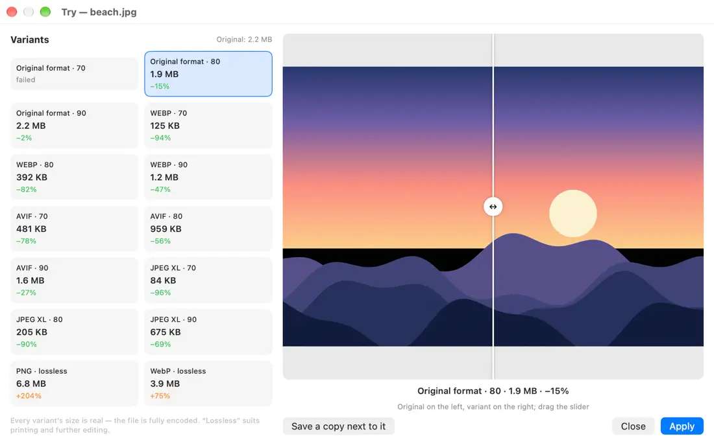</picture></p>

A window that compares one image in several variants side by side: quality 70/80/90, WebP, AVIF, JPEG XL and the original format, plus a “lossless” mode for print. Each variant has its real size (the file is fully encoded), the savings and a before/after slider. Pick a variant and press “Apply”. Open it from the “Try” button on the card, the triflX menu, Finder → triflX → “Try variants…”, the ⌃⇧V hotkey, or `triflx try file [--keep folder]`.

### Source profiles
<p align="center"><picture><source media="(prefers-color-scheme: dark)" srcset="assets/shots/en-dark-p-profiles.webp">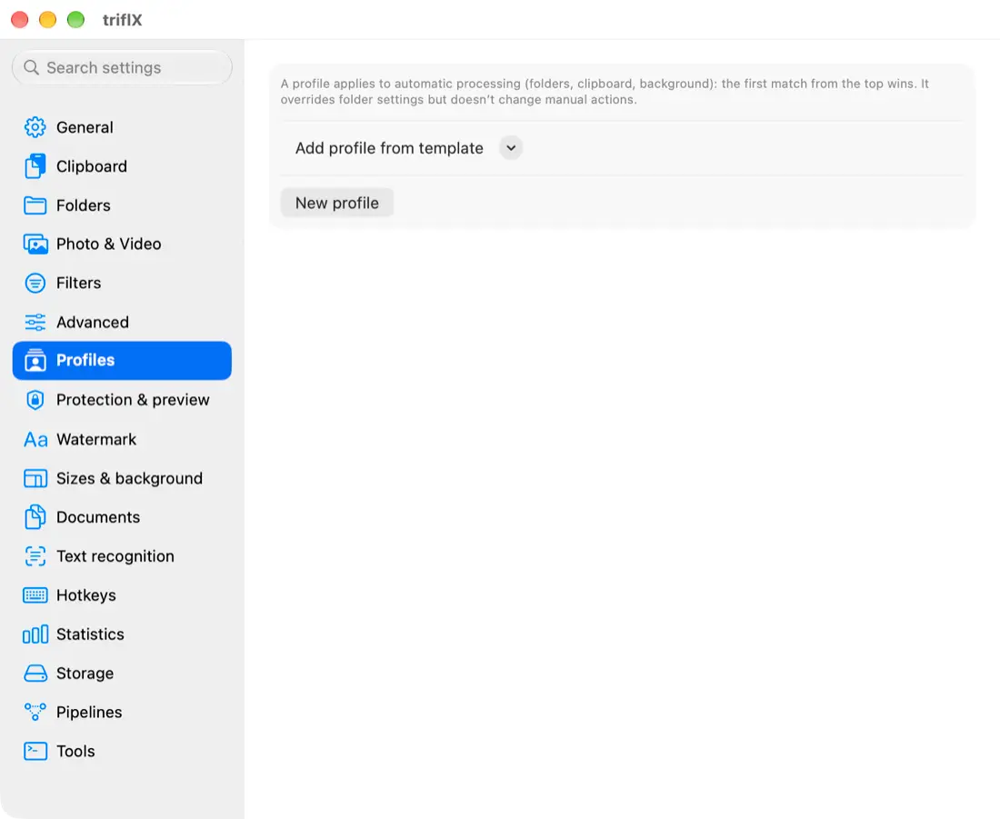</picture></p>

Settings → “Profiles”. A profile matches by folder, app (clipboard), screenshots, the site a file was downloaded from, or part of the name. A profile sets format, quality, scale, maximum side, metadata, a “fit into N MB” limit, replace or copy mode, or “leave alone”. It applies to automatic processing: the first match from the top wins, it overrides folder settings and doesn’t change manual actions. A profile can be based on a pipeline.

### Fit into a size
One goal, with parameters chosen per type: quality and scale (images), a resolution ladder (video), dpi (PDF). If the target is unreachable you get the smallest possible result and a “size target not reached” note on the card and in the terminal. A file already under the limit is left alone. Where: the card (“Fit into size”: 2, 5, 10, 25, 50 MB or custom), the “25 MB (email)”, “10 MB (Telegram)” and “custom limit” presets, Shortcuts (Fit File to Size), the terminal `--max-size 25MB`, the batch window.

### Statistics
<p align="center"><picture><source media="(prefers-color-scheme: dark)" srcset="assets/shots/en-dark-w-stats.webp">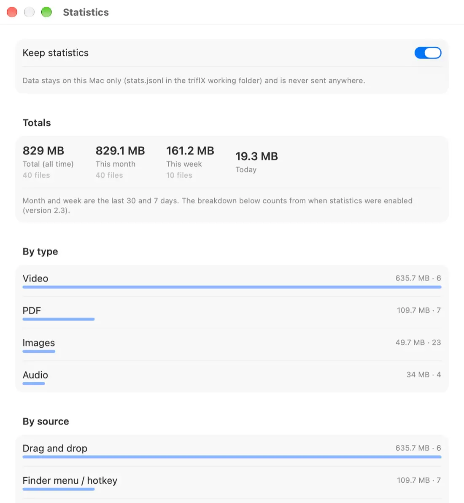</picture></p>

Menu → “Statistics…” or Settings → “Statistics”: total, month, week, today, file count, breakdowns by type, source and folder, and the biggest savings. Data stays on this Mac (`stats.jsonl`). There is an on/off switch and a “Reset statistics…” button. The week total is shown in the menu. Terminal: `triflx stats [--json]`.

### Drop on the menu-bar icon and the one-time window
<p align="center"><picture><source media="(prefers-color-scheme: dark)" srcset="assets/shots/en-dark-w-batch.webp">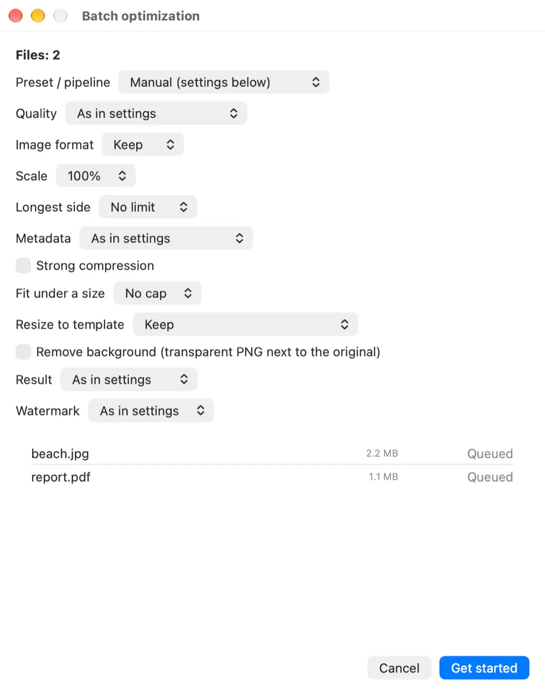</picture></p>

Drop files on the triflX menu-bar icon to open the batch window with settings for this run only (format, size, limit, background, watermark). Hold ⌥ when dropping to compress right away, ⌘ for strong compression. To skip the window: General → “Skip the settings window when dropping on the icon”. The same window: menu → “Process files…”.

### Hotkeys
<p align="center"><picture><source media="(prefers-color-scheme: dark)" srcset="assets/shots/en-dark-p-hotkeys.webp">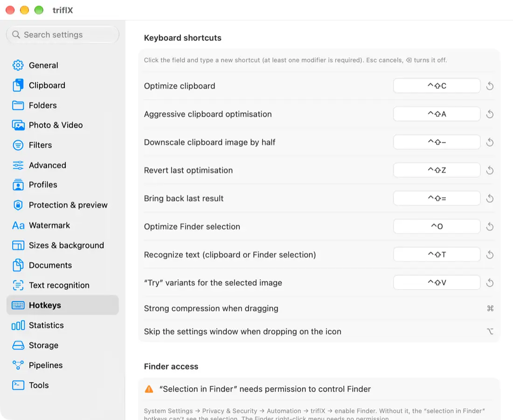</picture></p>

Settings → “Hotkeys”: click the field and type a shortcut (at least one modifier; Esc cancels, ⌫ turns it off). Available: optimize the clipboard image, **selection in Finder**, strong and medium compression, restore the original, restore the last one, OCR (⌃⇧T), “Try” (⌃⇧V). “Selection in Finder” needs permission to control Finder: System Settings → Privacy & Security → Automation → triflX → Finder. Settings has a “Request / check” button and shows a hint when access is missing. The Finder right-click menu needs no permission.

### Originals and rollback by time
<p align="center"><picture><source media="(prefers-color-scheme: dark)" srcset="assets/shots/en-dark-w-history.webp">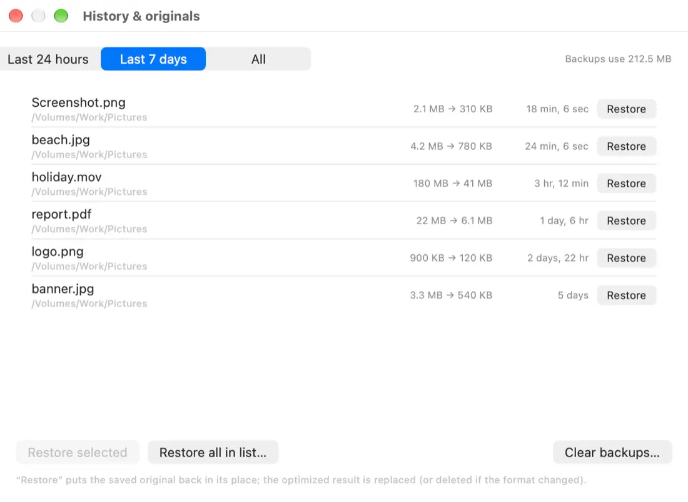</picture></p>

Settings → “Storage”: “Don’t keep” (≈30 minutes for the “Restore” button), “Keep for N days”, “Keep up to a size limit” (oldest deleted first). Backups younger than two minutes are never deleted. Auto-cleanup runs at launch and every 10 minutes, the used space is shown, and there is “Clear now…”. The **“History & originals”** window (menu): restore for the last 24 hours, 7 days, everything, or selectively.

### Safe preview
Settings → “Protection & preview”. Off by default. Before replacing a file it shows before/after and asks: **Replace**, **Keep original** or **Save a “.min” copy**. It can be enabled separately for automation and manual actions, and limited to folders and types. The choice can apply to the next files for 2 minutes.

### Processing protection
<p align="center"><picture><source media="(prefers-color-scheme: dark)" srcset="assets/shots/en-dark-p-protect.webp">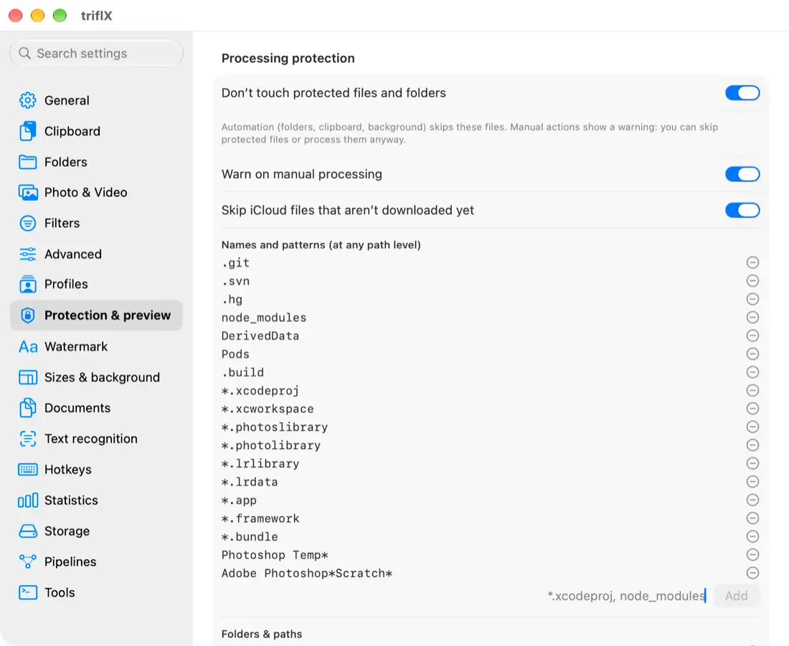</picture></p>

Settings → “Protection & preview”. Protected by default: `.git`, `.svn`, `.hg`, `node_modules`, `DerivedData`, `Pods`, Xcode projects and workspaces, Photos and Lightroom libraries, `.app`/`.framework` bundles, Photoshop and Adobe caches, system folders, iCloud files that aren’t downloaded yet, and triflX’s own backups. The name, path and type lists are editable, with add-folder buttons and “Reset to defaults”. Automation (folders, clipboard, background) skips them. Manual actions show a warning: “Skip protected” or “Process anyway”. The terminal refuses without `--force`.

### Watermark
<p align="center"><picture><source media="(prefers-color-scheme: dark)" srcset="assets/shots/en-dark-p-watermark.webp">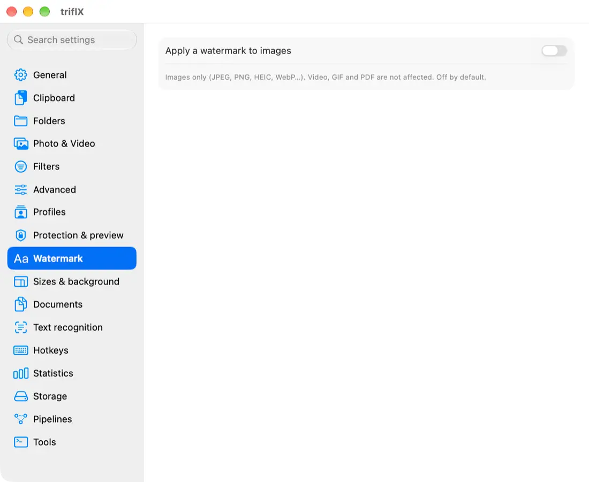</picture></p>

Settings → “Watermark”. Off by default. Text or image, position (3×3 grid), size (% of width), opacity, font, colour, shadow, margin; a live preview in settings. Enabled separately for automation, presets and manual actions, and can be limited to types and folders. Terminal: `--watermark TEXT --wm-pos br --wm-opacity 0.5 --wm-size 25`, `--no-watermark`. Images only. Don’t enable it for automation without the “already optimized” tag: a file would get the mark again.

### Documents
<p align="center"><picture><source media="(prefers-color-scheme: dark)" srcset="assets/shots/en-dark-p-docs.webp">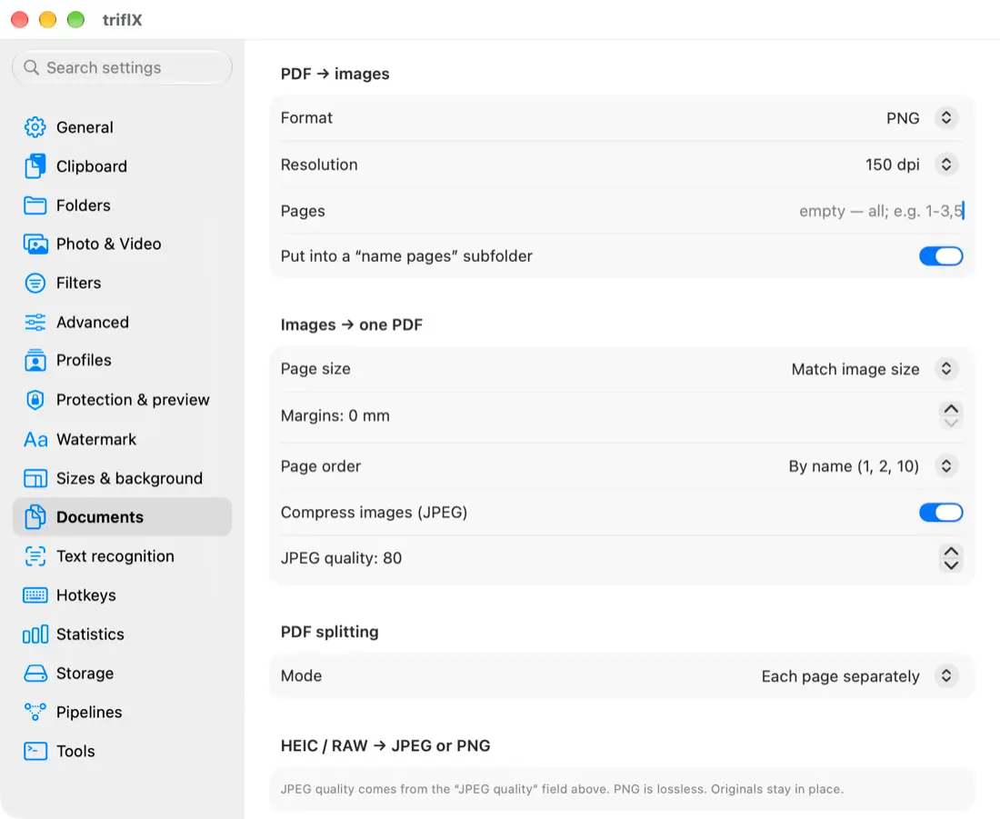</picture></p>

Settings → “Documents”. The triflX menu → “Documents”, Finder → triflX → “Documents”, Shortcuts, and the terminal `triflx convert`.
- **HEIC / RAW → JPEG or PNG**.
- **PDF → images**: PNG/JPEG/WebP, dpi, page range (`1-3,5`), a “name pages” subfolder. `triflx convert pdf2img --format png --dpi 150 --pages 1-3 file.pdf`.
- **Images → one PDF**: order (name, date, as selected), page size (match image, A4, Letter), margins in mm, compression. `triflx convert img2pdf --page a4 --order given -o out.pdf photos...`.
- **Merge PDFs**: `triflx convert merge -o out.pdf a.pdf b.pdf`.
- **Split PDF**: one page each, every N pages, or by ranges. `triflx convert split --every 2 file.pdf`, `--ranges 1-3,4-6`.

The result is always saved next to the source files; originals are not changed.

### Background removal and resize to template
<p align="center"><picture><source media="(prefers-color-scheme: dark)" srcset="assets/shots/en-dark-p-sizes.webp">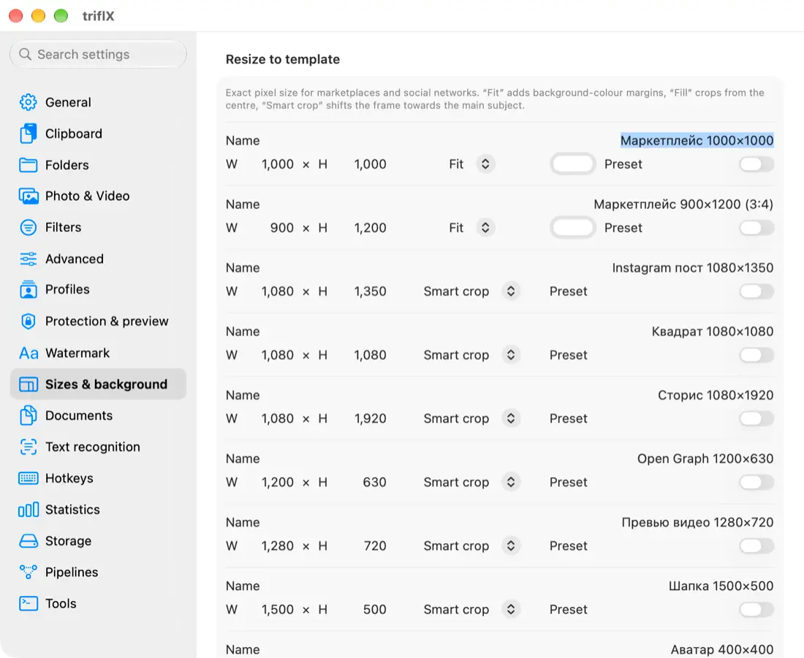</picture></p>

- **Remove background** (macOS 14 or later; hidden on macOS 13): Vision cuts out the main subject and saves “name-nobg.png” with transparency (or a white/custom background, with an optional “crop to the subject”). Runs on-device. Card, menu, Finder, Shortcuts, terminal `triflx remove-bg file`.
- **Resize to template**: exact pixel size for marketplaces and social networks. Built in: marketplace 1000×1000 and 900×1200, Instagram 1080×1350, square 1080×1080, story 1080×1920, Open Graph 1200×630, video thumbnail 1280×720, header 1500×500, avatar 400×400. Modes: “Fit” (margins in the background colour), “Fill” (centre crop), “Smart crop” (the frame shifts toward the main subject). Custom templates and “show in the preset list”: Settings → “Sizes & background”. Terminal: `--template ig-post` or `--template 1080x1350:fit`.

### Text recognition (OCR)
<p align="center"><picture><source media="(prefers-color-scheme: dark)" srcset="assets/shots/en-dark-p-ocr.webp">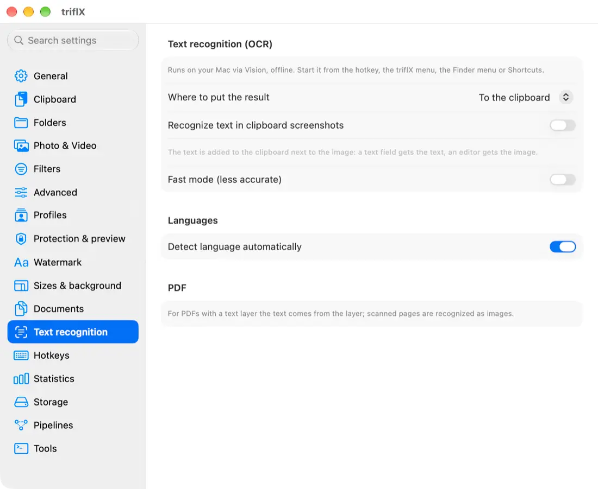</picture></p>

On-device Vision, offline. Images and PDFs (a PDF with a text layer uses the layer; scanned pages are recognized). Output: clipboard, a `.txt` next to the file, or both; language choice (order matters), a fast mode, and “recognize text in clipboard screenshots” (the text is added to the clipboard next to the image). Start it with ⌃⇧T, the triflX menu, Finder → triflX, Shortcuts (Recognize Text), or `triflx ocr [--lang ru,en] [--txt] file...`.

### New Shortcuts actions
Fit File to Size, Resize to Template, Remove Background, Recognize Text, PDF to Images, Images to PDF, Merge PDFs.

### Finder menu
A “triflX…” item with a submenu: try variants, OCR, remove background, resize to template, documents (PDF → images, images → PDF, merge, split, HEIC/RAW → JPEG/PNG). If the submenu doesn’t appear after updating: `killall Finder`.

### Version 2.4
- **Audio loudness.** Targets: -14 LUFS (streaming), -16 (Apple Music, podcasts), -23 (broadcast, EBU R128). Loudness is measured per ITU-R BS.1770 with double gating and gain is capped by a -1 dB peak, so audio does not clip. Quiet tracks are brought up to target; loud ones are not squeezed. Output: AAC in M4A, tags kept.
- **Cover art.** Keep, shrink (to 600 px JPEG) or remove. Handy for podcasts and libraries where the cover outweighs the track.
- **MRC for PDF scans.** Off by default. A scanned page is split into a background (paper colour, 120 dpi, JPEG) and a text mask (1 bit, 300 dpi). Text stays sharp and size drops several times. Pages with a text layer, rotation or no large image are unchanged. Output text is black: for coloured or faint text compare with the original (kept in the backup).
- **Signed PDFs** are skipped because any change breaks the signature.
- **Sleep.** The Mac stays awake during long video, PDF and audio jobs.
- **HDR.** JPEG and HEIC with a gain map (e.g. iPhone) stay HDR. WebP, AVIF, JPEG XL and PNG do not keep HDR; crop, watermark or a size template also drop it.
- **Security.** `triflx://` links from other apps and sites need confirmation; Finder menu links are signed and pass at once. MCP cannot bypass protected folders (`--force` is CLI only).

### Terminal: what’s new
`--template`, `--remove-bg`, `--lossless`, `--quality 1..100`, `--watermark`, `--force`, commands `ocr`, `remove-bg`, `try`, `stats`, `convert pdf2img|img2pdf|merge|split`, `selftest`. The MCP `optimize_file` tool gained `template`, `remove_background`, `lossless`, `force`.

## 20. Scenarios: set it up for a task

### Send a file in Telegram or another messenger
1. For images: the “Telegram” preset (card → “For messenger”, or menu → “Preset for the Finder selection”).
2. For video: in “Photo & video” choose the “For messenger” scenario, or press “For messenger” on the video card; need a limit? “Fit into size” → 10 MB.
3. Want it automatic? A profile by “App (clipboard)” with the app identifier (for example `ru.keepcoder.Telegram`) and JPEG 85.

### Send by email
Card → “Fit into size” → 25 MB, or the “25 MB (email)” preset. For scanned PDFs triflX lowers the dpi in steps; if the target is unreachable, the card says so. Several files: drop them on the icon → in the one-time window choose “Fit into size”.

### Prepare for a website
Convert to WebP or AVIF (the “Convert to WebP” pipeline or `--convert webp`), a maximum side of 1600-2400 px (`--max-dim`), metadata “strip” (removes EXIF and location). Compare formats in the Try window (⌃⇧V). For covers and previews use “Resize to template” (Open Graph 1200×630).

### Prepare for print
The “lossless” mode (in Try or `--lossless`) and do **not** reduce the scale. Turn on Safe preview so nothing is replaced by accident; in a profile for the “Print” folder choose “leave alone”. The original can always be restored from History.

### Marketplace and social networks
“Resize to template”: marketplace 1000×1000 (“Fit” mode with a white margin), Instagram 1080×1350 (“Smart crop”). Need a clean background? “Remove background” (macOS 14+) and then the template. Your own template: Settings → “Sizes & background” → “Add template”.

### Screenshots with text
Turn on “Recognize text in clipboard screenshots” in “Text recognition”: after a screenshot the clipboard holds both the image and the text. ⌃⇧T recognizes text from the clipboard or the Finder selection.

### A project working folder (code and design)
Automation leaves `.git`, Xcode, `node_modules` and Adobe caches alone. Add your own paths in “Protection & preview”. Manual actions will warn you.

## 21. Troubleshooting

| Symptom | What to check |
|---|---|
| A file wasn’t processed | It’s in a protected location (“Protection & preview”), already marked “optimized” (manual runs ignore the mark), doesn’t pass “Filters” (size, type), or is already optimal (the card says so). In the terminal, `--force` bypasses protection. |
| “Selection in Finder” (⌃O) doesn’t work | System Settings → Privacy & Security → Automation → triflX → enable Finder. “Hotkeys” has a “Request / check” button. The Finder right-click menu needs no permission. |
| No triflX item in the Finder menu | System Settings → Extensions (Finder) → enable triflX, then `killall Finder`. There is also a switch in “Tools”. |
| A hotkey doesn’t fire | Another app uses it, or it’s turned off. Assign a different shortcut in “Hotkeys”. |
| No “Remove background” item | It needs macOS 14 or later; on macOS 13 the items are hidden. |
| “Size target not reached” | The limit is too small for this file: you got the smallest possible result. Raise the limit or lower the resolution. |
| MKV/WebM video isn’t compressed automatically | Tick the extension in “Advanced → Compatibility → Video → MP4”. |
| An iCloud file was skipped | It isn’t downloaded yet (“Protection”). Download it in Finder (cloud icon) and retry. |
| The Try window takes a while | AVIF and JPEG XL are fully encoded; big images can take up to a minute. Finished variants appear as they complete. |
| Running low on disk space | “Storage” → “Don’t keep”, or a size limit, then “Clear now…”. |
| Need the original back | Card → “Restore original”, ⌃⇧Z, menu → “Recent”, or the History & originals window. |

Error log: menu → “Show error log” (stored locally and never sent anywhere). “Report a problem…” opens a GitHub form: attach the log yourself after checking it contains no personal paths.

## 22. Uninstall
1. Quit triflX (menu → “Quit”) and drag `triflX.app` from Applications to the Trash.
2. If you enabled “Launch at login”: System Settings → General → Login Items - make sure triflX isn’t there.
3. If you installed the command: delete the symlink `~/.local/bin/triflx`.
4. To erase data (settings, statistics, originals backups): in Finder → Go → Go to Folder… → `~/Library/Application Support/triflX`, move the folder to the Trash. Settings: `defaults delete com.trifl.x` in Terminal.
5. The Finder extension and Shortcuts actions disappear with the app. Before deleting the backups folder make sure you no longer need the originals.
